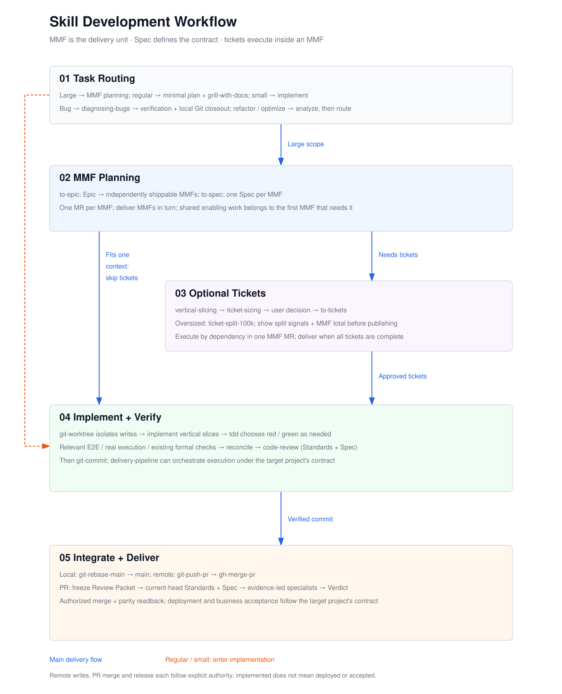

# Agent Development Workflow

[中文](README.zh-CN.md)

This repository combines requirement shaping, map planning, spec and ticket creation, automated dispatch, and local Git closeout into one resumable development workflow. `skills/` is the canonical runtime source. Third-party suites contribute only curated upstream snapshots; standalone single-Skill projects stay in upstream clones and are consumed through symlinks.

[](docs/assets/development-workflow.en.svg)

[View full-size SVG](docs/assets/development-workflow.en.svg) · [Download PNG](docs/assets/development-workflow.en.png)

The diagram follows the MMF delivery chain: planning, optional tickets, implementation and verification, then authorized integration and delivery. See [Task Routing](#task-routing) for individual Skills. Regenerate the SVGs with `python3 docs/assets/render-development-workflow.py`, then validate and export PNGs with [fireworks-tech-graph](https://github.com/yizhiyanhua-ai/fireworks-tech-graph).

## Task Routing

| Task type | Workflow |
| --- | --- |
| Large requirement | `to-epic` cuts the Epic into MMFs → `to-spec` writes one Spec per MMF → `vertical-slicing` cuts the MMF into tickets → `ticket-sizing` gives each ticket a split signal plus the MMF's ticket count and total, and the user decides whether to proceed or re-cut → tickets past the split line go to `ticket-split-100k` → `to-tickets` publishes → implement; each MMF ships as one MR, and an MMF that fits one context skips the tickets |
| Regular requirement | the model drafts a minimal plan → `grill-with-docs` stress-tests it → `implement` |
| Small change | `implement` directly; `tdd` decides per change whether a failing check comes first |
| Refactor or optimization | Analyze with either `improve-codebase-architecture` or `productionize-app-with-services` → classify the resulting work by size → follow the large- or small-requirement workflow above |
| Bug | `git-worktree` → `diagnosing-bugs` → `git-commit` → `git-rebase-main` |
| Understand existing code | `investigate` runs a read-only investigation: it routes mechanism questions to `how`, adds `why` for motivation, and answers decisions with a recommendation and tradeoffs |
| Assess a change's blast radius | `blast-radius` proves what a change breaks beyond the diff by running real code; foggy, wide impact goes to `wayfinder` |
| No scripted way to prove a project works | Run `create-verification-skill` once per project to generate a local `verify-<app>` skill; `maintain-verification-skill` keeps its feature map honest |

Every row that writes files starts in its own tree from `git-worktree`, even a one-line doc fix; the main checkout only integrates. `git-worktree` supports any number of task trees, symlinks `node_modules`/`.env`/`.venv` from main instead of reinstalling, and reclaims merged, clean, idle trees before creating a new one.

Refactor and optimization analysis is also a pre-routing step, not an independent delivery path. Pushes, pull requests, and remote merges always require separate authority.

When a pull request reaches review, `gh-merge-pr` freezes one Review Packet, runs `code-review` as the main Standards and Spec review, and adds specialist reviews only when the request, changed paths, or main findings provide evidence. The current-head verdict must pass before a separately authorized merge and parity readback.

## Install the Skill Bundle Once

```bash
git clone https://github.com/Dimon94/skills.git \
  "$HOME/.local/share/dimon-agent-workflow/skills"
cd "$HOME/.local/share/dimon-agent-workflow/skills"
./scripts/install-development-workflow.sh
./scripts/install-development-workflow.sh --check
```

The script clones or fast-forwards standalone dependency repositories, then links repository-owned Skills, curated snapshots, and standalone Skills into `~/.agents/skills` and `~/.claude/skills`. It refuses to replace a real directory with a symlink. A dependency checkout with local changes is preserved and not updated.

To let an AI Agent inspect the environment, install runtime dependencies, and verify the result, paste the prompt from the [one-paste Agent bootstrap guide](docs/agent-bootstrap.md).

## Dependency Repositories

| Repository | Workflow responsibility | Standalone install |
| --- | --- | --- |
| [Dimon94/skills](https://github.com/Dimon94/skills) | `implement`, `tdd`, `code-review`, `to-spec`, and local delivery Skills such as `git-commit` and `git-rebase-main` | [`scripts/link-skills.sh`](scripts/link-skills.sh) |
| [mattpocock/skills](https://github.com/mattpocock/skills) | Research, grilling, architecture analysis, Wayfinder, and tickets | [Installation](https://github.com/mattpocock/skills#installation-30-second-setup) |
| [swyxio/skills](https://github.com/swyxio/skills) | Upstream source for the curated `productionize-app-with-services` snapshot | Included by this repository's installer |
| [cursor/plugins](https://github.com/cursor/plugins) | Upstream source for the `thermo-nuclear-code-quality-review` snapshot and the adapted `how`, `why`, `blast-radius`, `investigate`, and verification-skill pair | Included by this repository's installer |
| [humanlayer/skills](https://github.com/humanlayer/skills) | Upstream source for the curated `show-me` snapshot | Included by this repository's installer |
| [Kappaemme-git/codex-complexity-optimizer](https://github.com/Kappaemme-git/codex-complexity-optimizer) | Standalone `complexity-optimizer` Skill | Linked directly by this repository's installer |
| [Dimon94/delivery-pipeline](https://github.com/Dimon94/delivery-pipeline) | Automated dispatch, integration, testing, and review from a Map or Spec | [Install](https://github.com/Dimon94/delivery-pipeline#install) |
| [Dimon94/brainstorming-only](https://github.com/Dimon94/brainstorming-only) | `brainstorming-only` and `office-hours-only` | [Quick Install](https://github.com/Dimon94/brainstorming-only#quick-install) |
| [fireworks-tech-graph](https://github.com/yizhiyanhua-ai/fireworks-tech-graph) | Generate and validate architecture, flow, and technical diagrams | [Installation](https://github.com/yizhiyanhua-ai/fireworks-tech-graph#installation) |
| [Second Opinion](https://github.com/Dimon94/codex-with-chatgpt) | Optional high-level planning and independent review | [One-paste install](https://github.com/Dimon94/codex-with-chatgpt#one-paste-install--一段话安装) |
| [Herdr](https://github.com/thinkerisme/herdr) | Terminal multi-agent runtime used by `delivery-pipeline` | [Install](https://herdr.dev/install) |

`delivery-pipeline` also needs at least one installed worker CLI: pi, Codex CLI, or Claude CLI. Codex App uses native Tasks and Worktrees and does not require Herdr.

## Repository Boundary

- `AGENTS.md`: repository working contract.
- `GLOSSARY.md`: canonical vocabulary.
- `docs/architecture/current-system-map.md`: modules, dependencies, and verification entry points.
- `skills/`: the canonical source for repository-owned Skills and curated upstream snapshots.
- `scripts/link-skills.sh`: links repository-owned Skills and upstream snapshots from `skills/`.
- `scripts/install-development-workflow.sh`: installs the complete development-workflow Skill Bundle.
- `skills/sync-upstream-skills/references/sources.json`: source, path, commit, and content hash for every upstream snapshot, plus `knownBrokenLinks` for links inside a snapshot that this repo does not import.
- `skills/sync-upstream-skills/references/adapted-sources.md`: upstream source and base commit for repo-owned Skills adapted from upstream.

Run `$sync-upstream-skills` to check curated snapshots; it writes only after an explicit update request. Standalone single-Skill projects still update through their upstream clone, and symlinks consume the result immediately.

## Principle Leaves

`skills/principle-*` are pstack principle snapshots, locked by the `cursor-pstack` source in `sources.json`. Host Skills and docs point to a leaf at the decision it governs and never copy its text. See `docs/adr/0009-principle-leaves-and-index.md`. `dimon-mode` is the explicit-only working-style entry that lists every leaf (`docs/adr/0010-dimon-mode-entry.md`).

| Leaf | Host |
| --- | --- |
| `principle-model-the-domain` | `to-spec` (Implementation Decisions) |
| `principle-redesign-from-first-principles` | `to-spec` (Implementation Decisions) |
| `principle-fix-root-causes` | `docs/agents/debugging.md` §4 |
| `principle-separate-before-serializing-shared-state` | `vertical-slicing` (step 5, dependency edges) |
| `principle-migrate-callers-then-delete-legacy-apis` | `vertical-slicing` (step 4, structure slices; exception mode: check 6 in `references/release-per-ticket.md`) |
| `principle-laziness-protocol` | `implement` (step 2, subtract first) |
| `principle-subtract-before-you-add` | `implement` (step 2, subtract first) |
| `principle-minimize-reader-load` | `implement` (step 4, ablation before reconciliation) |
| `principle-test-behavior-not-implementation` | `tdd` (step 3, assertions survive internal changes) |
| `principle-prove-it-works` | `implement` (step 3 exit, results read from the real artifact) |
| `principle-build-the-lever` | `implement` (step 2, non-trivial slice gets a rerunnable script) |
| `principle-encode-lessons-in-structure` | `retro` (step 1 recurrence, step 4 structural pass) |
| `principle-never-block-on-the-human` | `dimon-mode` (自主权) |
| `principle-boundary-discipline` | `AGENTS.md` `<principle_index>` (replaces the boundary line in `<constraints>`) |
| `principle-sequence-verifiable-units` | `AGENTS.md` `<principle_index>` (replaces the minimal-slice line in `<principles>`) |
| `principle-type-system-discipline` | `dimon-mode` (原则·架构) |
| `principle-make-operations-idempotent` | `dimon-mode` (原则·架构) |
| `principle-outcome-oriented-execution` | `dimon-mode` (原则·核心) |
| `principle-explain-the-number` | `dimon-mode` (原则·验证) |
| `principle-attack-the-premise` | `dimon-mode` `playbooks/bug-fix.md` (step 5, two failed fixes on one premise) |
| `principle-foundational-thinking` | `dimon-mode` (原则·核心) |
| `principle-exhaust-the-design-space` | `AGENTS.md` `<principle_index>` (index line carries the rule; upstream 08bd59b cut the body) |
| `principle-experience-first` | `dimon-mode` (原则·核心) |
| `principle-guard-the-context-window` | `dimon-mode` (子代理; `session-pickup` step 2) |

Adding a leaf changes four places: the `cursor-pstack` source, the principle section of `dimon-mode`, the `<principle_index>` block in `AGENTS.md`, and this table. Import a leaf only when a host points to it.
