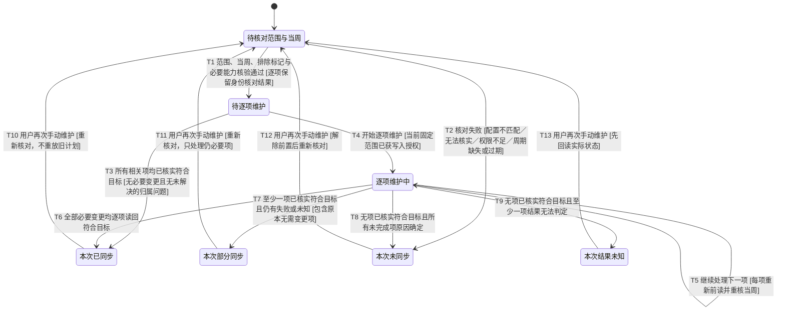

# M1 Spec：用户可手动维护 Linear 本周工作集合与跨周结转

- 父 Epic：[DD-539](https://linear.app/erplus/issue/DD-539)
- Linear Spec：[DD-540](https://linear.app/erplus/issue/DD-540)；本地文件为发布快照，后续合同修订以 Linear 为准。
- 规格状态：**设计合同完整；用户已确认手动 Skill 验收 Seam；未实施、未验证真实周期维护。**
- 交付边界：一个 MMF、一份 Spec、一个 MR；M2 自动调用与 M3 人工周报不在本 Spec。

## MMF 判定（to-spec 第 2 步）

1. **切成两半，存在一种切法让每半都能单独上线且单独有人用吗？——否。** 在已确认的 M1 边界内，本周集合维护与跨周未交付结转共同构成一次可信的周期维护；只交身份映射、周区间、排除标记、正式交付判断或增量写入中的任一部分，都不能独立给用户可用的周期维护结果。普通开发自动调用与人工周报是能独立使用的结果，已分别归为 M2、M3，不并回本 Spec。
2. **整体单独上线有人用吗？——是。** 开发负责人无需等待 M2/M3，即可对一个明确的 Linear 团队／项目范围手动执行维护，得到本周进行中工作集合、持续排除、未交付跨周结转以及逐项可核对的同步结果。

**结论：正好一个 MMF，继续编写 M1 Spec；没有发现新的独立用户结果。**

## Problem Statement

开发负责人需要在 Linear 中看到一个可信的“本周工作集合”：进行中的 MMF 父 Spec Issue 与 ticket 应在一起，跨周未完成的工作继续出现，无关的未开始 Backlog 不应灌入，主动剔除的工作也不应被后续维护无声加回。

当前周期归属、任务状态与真实交付事实并不等价。Linear 原生滚动只能移动任务，不能证明 Spec 要求已满足或工作已实际合入 main；Integration、ticket Done、HTTP 200 和正文自称完成也都不能替代这些证据。已核实的团队样本还是双周 Cycle，不能直接当作 Asia/Shanghai 的单周。若只按状态或标题同步，会把已交付工作滚入新周、把未交付工作误记完成，或在跨周时复制任务、丢失原执行现场。

用户还需要知道每一次手动维护到底发生了什么。配置不匹配或不可核实、权限不足、过期周期、部分成功、结果未知与重复执行必须有稳定结果；同步失败不能阻断原开发、派发、预算或恢复，也不能以“整批成功”掩盖只写入了一部分。

## Solution

新增 `delivery-cycle` Skill，作为周期维护规则与正式交付判断的唯一 owner。开发负责人对一个明确的 Linear 团队／项目范围手动调用维护动作，并可同时提交明确的剔除或恢复选择。该动作：

1. 按 Asia/Shanghai 的周一 00:00 计算左闭右开的本周区间，核对真实团队、项目、Cycle 和原 MMF 父子身份；不把双周切成单周，不私自改团队配置或创建第二套周期引擎。
2. 默认纳入进行中的父 Spec Issue 与 ticket，包括跨周未完项；不因预计做不完而排除，也不自动纳入未开始 Backlog。Epic 只保留跨期总览，不作为本周工作项。
3. 用原平台的专用持久标记保存显式剔除，直到用户恢复；以增量 cycle／标签变更维护归属，保留其他标签、工作流状态、原 Issue、branch 与执行现场。
4. 通过同一个公开正式交付判断消费原项目的 Spec 验收与真实 main 合入证据。只有两者同时满足才是“已正式交付”；未交付继续结转，证据不足保持 `Unknown`，状态漂移交原 owner 核对。
5. 每项变更执行前读、必要增量写入和结果回读。返回整批状态、逐项实际归属、交付判断、已验证变更、未变更项及具体失败／Unknown；不承诺跨人、跨宿主或跨批次全局原子更新。

M2、可选 pipeline 适配与 M3 以后只消费本 Module 的同一 Interface。本 MMF 不实施自动 hooks 或报告，也不新增本地任务数据库。

## Business Flow



- R1：本周是 Asia/Shanghai 周一 00:00 起、下一周一 00:00 止的左闭右开区间；目标 Cycle 的实际边界必须与该区间一致，并能核实团队为一周、周一、连续周期配置。双周不能当周用；配置不匹配或必要配置无法核实时不得写入。
- R2：只维护请求中真实存在且获授权的团队／项目；完整分页并用平台 ID、原 Spec 引用与 `parentId` 回源 MMF 父子身份，不按标题猜测。Epic 保持跨期总览，不纳入、结转或计作一个本周 MMF；身份无法核实的项不得猜测性写入。
- R3：父项进行中或任一执行 ticket 进行中，均表示所属 MMF 正在推进；必须纳入经身份核实的父 Spec Issue 与进行中 ticket，即使父项状态仍是 Backlog，也不改其工作流状态。跨周未完项同样适用；不得按预计完工时间筛选，不得把无进行中关联的 Backlog 或所有未开始兄弟票灌入。仍需工作的 ticket 随原父子关系保留，已完成子票不被重算为新 MMF。
- R4：只有“Spec 要求满足”与“实际 main 合入已证实”同时成立才是已正式交付。正式交付发生在本周的原工作保留在本周；仅能证明在本周开始前已正式交付的项才不得结转到本周。未交付或交付事实为 Unknown 的原候选继续结转，Unknown 不得改成已交付或未交付。已证实正式交付但缺少可靠发生时间时，保持原归属并报告时间证据缺口，不猜测所属周，也不据此移入或移出。
- R5：父 Issue Done 但未正式交付、或父 Issue Started 但已正式交付，均记为证据／状态漂移并交原 owner 核对；周期归属仍按 R4 的事实与时间证据处理，不直接按 Started／Done 删除归属。周期维护不得自行关闭、重开任务或改写交付事实。
- R6：显式剔除由原平台的专用标记持久保存，直到用户明确恢复；每次同步不得主动把有效剔除项加入本周。标记在 MMF 父项时，该 MMF 的经核实子项继承剔除；标记在单独 ticket 时只影响该项。恢复父项不清除子项自身的标记，恢复子项也不绕过父项标记；恢复后重新按当前规则判断，不强制纳入。原生自动归属若在平台侧重新加回，必须检出、尝试纠正或明确报冲突；不得承诺平台永不加回，也不得删除剔除标记来掩盖冲突。
- R7：只提交必要的 cycle 与增量标签变更；不得替换整份标签、改写工作流状态或其他任务属性，不得创建重复任务、复制 branch、重置执行现场或伪造历史周期。
- R8：没有已证实的 CAS 字段，因此不承诺跨人／跨宿主全局原子更新。每项写入前必须重读当前 Issue 与当周；写入前读已观察到原生滚动或他人变更使计划过期时，不得把新周任务移回旧周。若漂移发生在前读之后，只能以回读检出并报告，不能宣称已消除该竞态。
- R9：写入失败或结果未知后先回读；只有重新前读证明变更仍必要才能继续，禁止盲重放。已读回成功的项不因后续失败而自动回滚，部分成功必须保留为可恢复现场。
- R10：每次调用都有稳定的整体状态、逐项结果和机器可读原因；配置不匹配、无法核实、权限不足、结果未知、部分成功、过期周期与重复执行不得合并成笼统“成功”或“失败”。HTTP 200、mutation 返回或正文自称均不能替代业务字段回读。
- R11：同一实际状态下重复执行不产生第二次不必要写入，不创建重复 Issue、Cycle、标记或成果；重复执行必须返回可观察的无变更结果。
- R12：周期同步失败不改变原开发资格、依赖、派发、预算、恢复或授权，不成为执行 gate；M1 不接入自动 hooks。
- R13：每次真实写入仅限当前动作获授权的团队／项目、Issue 与字段；不私自改团队配置、创建 Cycle、归档／关闭／重开任务，也不新增 push、合并、部署或发布授权。
- R14：Spec 验收与原 closeout 分别拥有验收、main 合入事实；提交日期不是 main 落地事件时间。缺必要事实且没有明确 not_met 时交付判断保留 Unknown。两项事实均已证实时，正式交付时间为两项所需条件实际满足时间的较晚值；任一必要事件时间缺失则 `effectiveAt = null`，不推翻已证实的交付事实，但不能断言所属周期。不得倒填历史或用观察时间冒充发生时间。
- R15：Linear 拥有 Cycle、Issue 与剔除标记，原项目拥有 Spec／main 证据；M1 不建立第二份可变任务状态。M2、可选 pipeline 与 M3 只能消费同一正式交付判断，不得产生第二套公式。

未列出的转移一律禁止。每个 T 和 R 都是本 MMF 的 MR 验收项。“本次已同步”只表示本周归属与排除状态已读回符合目标，不表示任何 MMF 已正式交付。

## User Stories

1. 作为开发负责人，我希望对一个明确的 Linear 团队／项目手动维护本周集合，以便不等待自动接入或周报功能也能管理真实 Cycle。
2. 作为开发负责人，我希望系统按上海时区周一 00:00 识别本周并核对真实 Cycle，以便双周配置、错误边界或过期周期不会悄悄污染归属。
3. 作为开发负责人，我希望进行中的 MMF 父 Spec Issue 和 ticket 默认进入本周，包括上周仍未完成的工作，以便集合反映实际工作而不是完工预测。
4. 作为开发负责人，我希望未开始 Backlog 与跨期 Epic 不被灌入本周，以便本周集合不被无关范围淹没。
5. 作为开发负责人，我希望显式剔除一项工作后，该选择在原平台持续保存到明确恢复，以便后续手动或自动维护尊重我的决定。
6. 作为开发负责人，我希望恢复只让工作重新参与规则判断，以便已交付或仍不具备纳入条件的工作不会被强行加入。
7. 作为开发负责人，我希望结转以 Spec 验收和真实 main 合入为准，以便 Integration、ticket Done 或 HTTP 200 不会被误报为正式交付。
8. 作为开发负责人，我希望证据不足与状态漂移被明确标出，以便由原 owner 核对，而不是由周期工具猜测、关闭或重开任务。
9. 作为开发负责人，我希望跨周维护保留原 Issue、父子关系、branch 和执行现场，以便继续工作而不是重建任务或重复计算已完成子票。
10. 作为开发负责人，我希望重复执行只补齐仍必要的变更，以便原生滚动、重试或多人同时操作时不会产生重复任务、重复标记或错误回移。
11. 作为开发负责人，我希望看到逐项写入与回读结果，以及明确的部分成功和 Unknown，以便知道已经生效什么、下一步该恢复什么。
12. 作为开发负责人，我希望周期同步失败不影响原开发、派发、预算和恢复，以便辅助管理功能不会成为开发链路的单点阻塞。
13. 作为开发负责人，我希望维护只修改当前授权的 cycle 与增量标签，以便其他标签、任务状态、团队配置和发布权限不被顺带改变。
14. 作为后续自动化或周报的维护者，我希望复用同一个正式交付判断，以便不同入口不会对同一 MMF 得出互相矛盾的交付结论。

## Implementation Decisions

### 1. Module 与唯一 owner

只新增一个 Module：`delivery-cycle` Skill；不修改现有开发、closeout 或周报 Module。它拥有 T1–T13 与 R1–R15。周期判断、排除语义、正式交付判断和同步结果是同一个深 Module 的内部实现，不另建日期、身份、判定器或 DTO Module。

跨 Module 参与方如下，owner 不变：

| 参与方 | 参与规则 | 责任 |
| --- | --- | --- |
| Linear 平台及其连接 Adapter | R1、R2、R6–R10、R13 | 提供真实身份、配置、Cycle／Issue 读取，执行受限增量 patch 并支持回读；不拥有正式交付判断 |
| 原 Spec 验收 owner | R4、R5、R14、R15 | 提供带来源的 Spec 要求满足／未满足／Unknown 证据；不被周期同步改写 |
| 原 closeout owner | R4、R5、R14、R15 | 提供真实 main 合入与可用的合入事件时间；Integration 或提交日期不被提升为 main 事实 |

### 2. 公开 Interface

以下是要实现的设计合同，不是对现有 SDK 的描述。采用 Skill 内的 JavaScript 契约脚本与 JSDoc，不引入编译链。公开 Seam 只有一个：`delivery-cycle` 的手动 Skill 入口及其同名公开合同；M2／M3 调用同一 Module，不复制判断。

```js
/** @typedef {'verified'|'not_met'|'unknown'} EvidenceState */
/** @typedef {{state: EvidenceState, source: string|null,
 *             effectiveAt: string|null, reason: string|null}} Evidence */
/** @typedef {{status: 'delivered'|'not_delivered'|'unknown',
 *             spec: Evidence, main: Evidence,
 *             effectiveAt: string|null}} DeliveryAssessment */

/**
 * @param {{spec: Evidence, main: Evidence}} input
 * @returns {DeliveryAssessment}
 */
export function assessFormalDelivery(input) {}

/**
 * @param {{scope: {teamId: string, projectId: string,
 *                  exclusionLabelId: string},
 *          exclude: string[], restore: string[]}} request
 * @param {{linear: LinearPort, evidence: EvidencePort,
 *          now: () => Date}} dependencies
 * @returns {Promise<MaintenanceResult>}
 */
export async function maintainCurrentWeek(request, dependencies) {}
```

`Evidence` 是唯一证据形状：`verified` 表示该条件已有原 owner 证据，`not_met` 表示原 owner 明确证明未满足，`unknown` 表示缺证据或证据冲突。`source` 对前两者必填；`effectiveAt` 只记录真实业务事件时间，不知道就为 `null`，不得以读取时间或 commit date 填充。`DeliveryAssessment` 不再附带需要同步的 `specPassed`、`merged`、`delivered` 布尔标志。

`assessFormalDelivery` 的 **Ensures（R4、R14、R15）**：

- `verified + verified → delivered`；任一为 `not_met → not_delivered`；其余组合均为 `unknown`。
- 不读取 Linear statusType、ticket Done 数量、Integration、HTTP 200 或正文结论作为替代条件；不修改输入，不产生平台写入。
- 返回两项原证据及原因；仅两项均 verified 且必要事件时间均可核实时，effectiveAt 为两时间较晚值，否则为 null。M2／M3 只能消费同一结果，不另算正式交付或其发生时间。

`maintainCurrentWeek` 的 **Ensures（T1–T13、R1–R15）**：

- 入口固定一次 `startedAt = now()`，计算 `[weekStart, weekEnd)`；每项写入前再次调用 `now()` 并重读目标 Cycle 与 Issue。跨过周一后停止旧周计划，不写回旧周。
- 顺序为：完整读取并核验范围／配置／标记／身份 → 读取原证据并形成目标 → 逐项前读 → 仅提交必要增量 patch → 逐项回读。显式 `exclude` 与 `restore` 是这一次手动维护的输入，不是独立自动触发器。
- 仅当所有必要项都已符合或读回符合时返回 `synchronized`；至少一项已核实符合目标（含原本无需变更项）、但仍有失败或未知时为 `partial`；无项已核实符合目标且原因确定为 `unsynchronized`；无项已核实符合目标且仍有不可判定项为 `unknown`。返回结果绝不代表原开发已执行或业务已验收。
- 同步异常只进入本动作结果，不向原开发链路写入 gate、预算、恢复或派发状态。

`MaintenanceResult` 只保留调用者必需的形状，不建立完整 DTO 层：

```js
/**
 * @typedef {Object} MaintenanceResult
 * @property {'synchronized'|'partial'|'unsynchronized'|'unknown'} status
 * @property {{start: string, end: string, cycleId: string|null}} week
 * @property {number} changed
 * @property {Array<{issueId: string,
 *   action: 'include'|'exclude'|'restore'|'carry'|'not_carry'|'unchanged',
 *   write: 'verified'|'unchanged'|'failed'|'unknown',
 *   delivery: DeliveryAssessment|null}>} items
 * @property {Array<{code: string, issueId: string|null,
 *                   message: string}>} problems
 */
```

`changed` 只统计已回读确认的实际变更；`synchronized + changed = 0 + 所有相关项 write = unchanged` 是重复执行的可观察结果。`delivery = unknown` 可与 `status = synchronized` 同时出现：这表示未交付项已安全保留／结转，但交付证据仍是 Unknown，二者不得折叠成一个成功布尔值。

### 3. Adapter 合同与现有能力缺口

只注入本实现需要的两个内部 port；真实 Linear 与测试 fake、原证据与测试 fake 各构成两个 Adapter，因此这里有真实 Seam，但不把 port 暴露成新的公共 Module 或通用平台框架。

```js
// LinearPort：目标合同；现有连接器并未全部满足。
const linear = {
async readCycleConfiguration(teamId) {},
// Ensures R1、R13：返回时区、启用、一周、周一、cooldown、lock 与自动归属设置；
// 任一必需值不可读取时显式返回 unknown，不用基本 team 字段补齐猜测。

async listCycles(scope) {},
// Ensures R1、R2：完整分页，返回真实 id/startsAt/endsAt，不创建周期。

async listIssues(scope) {},
// Ensures R2、R3：完整分页，返回 id/statusType/labels/parentId/team/project/cycleId
// 及原 Spec 引用；不跨团队／项目取数，不按标题推断身份。

async readIssue(issueId) {},
// Ensures R8、R9、R10：返回写入前或回读时的实际 cycleId、labels、statusType、parentId。

async patchIssue(issueId, {cycle, addLabels, removeLabels}) {},
// Ensures R6、R7、R8、R13：只允许这三个增量字段；cycle 可为 cycleId 或 null；
// 不接受 labelIds、status 或其他任务字段，不把 HTTP 200 当作读回成功。

};
const evidence = {
async read(issueIdentity) {},
// Ensures R4、R5、R14、R15：返回原 owner 的 {spec, main} Evidence；
// 缺证据返回 unknown 与原因，不由 statusType、Integration 或 commit date 推导。
};
```

当前 `get_team` 基本身份响应不等于完整周期配置读取。若现有授权通道不能提供上述必需配置或写入／回读能力，结果是 `configuration_unverifiable` 或 `capability_unavailable`，不是假定成功。既有凭证直连 GraphQL 已得到 `Invalid scope: read required`，该通道当前不能冒充已授权读写 Adapter；不得在对话中索取或复制 secret。

### 4. 周期、身份与结转规则

- 配置必须核实为 `cyclesEnabled = true`、`timezone = Asia/Shanghai`、`cycleDuration = 1 week`、周一启动、无会打断连续单周的 cooldown；目标 Cycle 的实际 `startsAt/endsAt` 还必须精确等于计算区间。样本中的 11/16–11/30、11/30–12/14 双周边界不满足合同，不能固化到实现。
- 按真实范围内已核实的 MMF 聚合：父项或任一执行 ticket 的 `statusType = started` 时，纳入父 Spec Issue 与进行中 ticket，即使父项仍处 Backlog；同时处理上一周期中尚未被证明正式交付、仍需继续的原工作项。未开始 Backlog 不纳入；ticket 沿用所属 MMF 父项的交付判断，不单独产生 MMF 交付结论。
- 正式交付时间落在目标周内的原工作保留或关联该周；仅能证明在目标周开始前已正式交付时，才不结转或纠正原生滚入目标周的归属，并读回必要变更。若正式交付事实已知但事件时间缺失，保持原归属，返回 `delivery_time_unverifiable`，不依据当前观察时间决定移入或移出。不得为了清理归属而改动 Started／Done 状态，也不回写旧周伪造历史。
- 未正式交付或 Unknown 的原 MMF 父项继续结转；仅仍需工作的 ticket 随之保留。已完成子票不复制、不重开、不重算。父项状态与证据冲突时附加 `workflow_drift`，交原 owner 处理；已交付且时间缺失按上一条保留归属。
- 无原 MMF 身份或父子关系证据的项以 `identity_unverifiable` 报告；不得仅凭相似标题纳入、剔除或结转。跨范围 ID 返回 `scope_invalid`，不写入。

### 5. 显式剔除与恢复

- 每个团队使用一个专用 Linear 标签作为持久剔除标记，请求以其真实 `exclusionLabelId` 定位；标签本身及 Issue 标签关系都在 Linear，本地最多保存 scope／标签 ID 配置，不保存逐项排除副本。
- 当前没有查到既有可用标记。首次部署须在一个明确团队内、经单独明确授权 provision 该标签并回读 ID；例行维护不自动创建标签，也不改团队设置。标记缺失或不可核实返回 `exclusion_marker_missing`，不得用临时本地列表替代。
- `exclude` 对目标 Issue 增量添加标记；若它属于目标周，再提交 `cycle = null` 并回读。其他标签与状态不变。`restore` 只增量移除该 Issue 自身的标记，再按当前身份、状态和正式交付证据重新判断；不保证一定纳入。父 MMF 标记对已核实子项派生生效，不复制到所有子票；子票自身的标记仍独立保留，父项恢复不覆盖它。
- 自动归属／lock 使清空无效或立即加回时返回 `native_assignment_conflict`，保留剔除标记并停止该项成功声明。若平台在本次成功回读之后再次加回，下一次维护必须识别并再次纠正或报冲突；M1 不承诺无 CAS、无团队改配情况下的持续全局保证。

### 6. 稳定结果与恢复

| 情况 | 整体状态与稳定 code | 必须行为 |
| --- | --- | --- |
| 一周／时区／周一／连续配置不匹配，或实际 Cycle 不是该周 | `unsynchronized`；`configuration_mismatch` | 零写入；指出需由原团队管理员解除，不自行改配 |
| 必需配置无法读取或无法核实 | `unsynchronized`；`configuration_unverifiable` | 零写入；Unknown 明示，不以实际日期猜测全部设置 |
| 没有合规当周 Cycle | `unsynchronized`；`cycle_missing` | 不创建第二周期引擎 |
| 计划在执行中跨过周一或目标已过期 | 无已核实符合目标项为 `unsynchronized`，至少一项符合为 `partial`；`cycle_expired` | 停止后续旧周写入，回读已尝试项，等待新一次调用 |
| 权限不足或通道能力缺失 | 无已核实符合目标项为 `unsynchronized`，至少一项符合为 `partial`；`permission_denied`／`capability_unavailable` | 不扩大授权，不冒称已同步 |
| 某项身份不可核实 | 视其他项结果为 `unsynchronized` 或 `partial`；`identity_unverifiable` | 跳过该项写入，其余项不伪装成整批原子成功 |
| 写入明确失败或回读不符 | 视其他项结果为 `unsynchronized` 或 `partial`；`write_failed`／`readback_mismatch` | 保留实际状态，下一次重新前读 |
| 写入／回读无法判定 | 无已核实符合目标项为 `unknown`，至少一项符合为 `partial`；`write_unknown` | 先回读，禁止盲重放 |
| 原生自动归属与剔除冲突 | 视其他项结果为 `unsynchronized` 或 `partial`；`native_assignment_conflict` | 保留标记，不改状态，不声明持续排除成功 |
| 一部分已核实符合目标（可无需变更）、一部分失败或未知 | `partial` | 逐项列出 `verified`／`failed`／`unknown`，不回滚已成功项 |
| 重复执行且实际集合已符合 | `synchronized`；`changed = 0`，相关项 `unchanged` | 无第二次不必要 mutation，无重复对象 |
| 只有交付证据缺失 | 归属可满足时为 `synchronized`；该项 `delivery = unknown`，附 `evidence_unavailable` | 安全保留／结转但不宣称正式交付，交原 owner 补证 |
| 已正式交付但无法核实属于哪一周 | 无项已核实符合目标时为 unknown，其他项已符合时为 partial；delivery_time_unverifiable | 保持原归属，交付事实仍为 delivered，不猜测时间、不擅自移入或移出 |

所有失败结果都包含固定 code、受影响 Issue（若适用）与可读说明。GraphQL HTTP 200 仍须检查 `errors` 和业务字段；部分数据响应不得当整批成功。

### 7. 并发、重试与授权

- 不使用未证实的 `expectedUpdatedAt`／CAS。不依赖未经证实的跨字段、跨人或跨宿主事务保证；前读之后、patch 之前仍可能发生未观察漂移，增量 patch 也无法把该窗口变成原子操作。实现只能缩短窗口、按最新前读拒绝已知过期计划并回读报告，结果只承诺回读时观察到的事实，不承诺竞态已被根除。
- 每次重试都是一次新维护：重新读取配置、当周、Issue 和证据。只有实际状态仍不满足才提交该项 patch；不缓存旧计划后盲重放，不全批回滚。
- 原生滚动与手动维护同时发生时，以最新 Cycle／Issue 回读为准；若目标周已过期，停止，不把已滚入新周的 Issue 移回旧周。
- 例行 mutation 仅限当前请求固定 scope 内明确必要的 Issue、cycle 与增量标签。M1 不实施 M2 hooks，不自动归档／关闭／重开，不授予 push、merge、部署、发布、团队改配或批量迁移权限。

### 8. Seam 与 deletion test

- **Seam：**最高且唯一的公开测试面是 `delivery-cycle` 的手动 Skill Interface；同一入口覆盖判断、计划、写入和回读。现有 Linear 连接能力与原 Spec／closeout 证据入口作为 Adapter 复用，真实平台验收也从该公开入口发起。不新增第二套公共脚本入口、通用 SDK 或数据库 Seam。
- **新 Module deletion test：**删除 `delivery-cycle` 后，单周边界校验、真实身份过滤、持续排除、唯一正式交付公式、逐项恢复和稳定结果会在 M2、M3 与各调用方重新出现或消失；复杂度并未随删除消失，因此该 Module 有独立存在价值。删除它不应删除任何原 Issue、Spec 或 closeout 证据。

## Testing Decisions

### 测试原则与 prior art

- 只从 `delivery-cycle` 公开 Interface 观察返回结果、真实／fake Linear 的外部可见状态与 mutation 记录，以及原证据输入；不断言私有函数、内部计划对象或实现常量。
- 沿用本仓 Skill 前向验证案例与契约脚本行为测试的方式，为每条规则写独立预期：输入／动作、期望结果、来源（本 Spec、手算周区间或真实平台响应）。不得把实现输出复制成期望值。
- fake 只证明规则、错误处理与副作用控制；真实 Linear 配置、权限、原生归属和读回必须由最小授权范围的平台验收证明，二者不得互相冒名。
- 被测 Module 只有 `delivery-cycle`。`assessFormalDelivery` 与 `maintainCurrentWeek` 是同一公开 Module 的判断与维护入口；不要求为每个内部步骤新增测试 Module。

### T 覆盖

| 转移 | 通过公开 Interface 的检查与必须拒绝的错误实现 |
| --- | --- |
| T1 | 给定合规范围、单周 Cycle、标记和必要读取能力，进入逐项核对或无变更成功；逐项身份缺口保留为该项失败，不提升为全部身份已通过。拒绝缺全局前置仍写入。 |
| T2 | 分别注入配置不匹配、配置 Unknown、无权限、无合规 Cycle／过期 Cycle，结果均为 `unsynchronized` 及对应 code，mutation 数为零。拒绝把核对失败当成功或继续写入。 |
| T3 | 预置所有实际归属与标记已符合目标，返回 `synchronized`、`changed = 0`、相关项 `unchanged`，mutation 数为零。拒绝仍逐项 patch 的实现。 |
| T4 | 对固定授权 scope 内一个必要项调用维护，fake 只收到该项的允许增量字段；scope 外对象零写入。拒绝整批替换、越权字段或越范围写入。 |
| T5 | 两项处理之间改变第二项实际 Cycle，并让另一次运行跨过周一；实现必须重新前读，后一种情况停止旧周后续写入。拒绝按入口缓存计划全部写完。 |
| T6 | 所有必要 patch 的回读均满足目标时才返回 `synchronized`，`changed` 等于实际读回变更数。让 mutation 返回成功但业务字段不符时必须不能通过。 |
| T7 | 一项读回成功、一项失败或 Unknown 时为 partial。另给一项原本已符合、一项失败，仍为 partial 且 changed 可为 0。拒绝将无需写入视为没有完成任何项，或声明全批成功／自动回滚。 |
| T8 | 所有必要项均明确失败且无项已核实符合目标，返回 unsynchronized 与具体原因；权限拒绝和回读不符可区分。拒绝笼统 Unknown 或假成功。 |
| T9 | 无项已核实符合目标且至少一项写入／回读无法判定，返回 unknown 与 write_unknown，先回读而不重放。拒绝把超时、GraphQL errors 或空回读当成功。 |
| T10 | 从已同步状态再次调用，实际未变时无第二次 mutation；已变化时重新核对，不沿用旧成功。 |
| T11 | 从部分同步状态再次调用，只处理仍必要项，已符合的项不重复 patch；拒绝全批重放。 |
| T12 | 从未同步状态在前置解除后再次调用，重新核对配置、身份与实际归属；拒绝复用旧计划。 |
| T13 | 从结果未知状态再次调用时先回读，已生效项不重复 patch；拒绝把超时等同未执行而盲目重发。 |

### R 覆盖

| 规则 | 独立检查与必须拒绝的错误实现 |
| --- | --- |
| R1 | 手算并断言 `2026-11-15T16:00:00Z` 属于上海 `2026-11-16 00:00` 起的新周，前一微秒仍属旧周；目标区间在下一周一 00:00 结束（不含该时刻）。用 11/16–11/30 双周响应必须得到 `configuration_mismatch` 且零写入；配置读取 Unknown 必须得到 `configuration_unverifiable`。拒绝双周截半、固定 UTC 周或自行改配。 |
| R2 | 两页结果中混入相同标题、跨团队／项目项、Epic 与断开的父子关系；只有完整分页后由真实 ID／原 Spec 引用确认的父 Spec Issue 与 ticket 可被维护。Epic 不进入 Cycle，身份不明项报 `identity_unverifiable`。拒绝标题匹配、漏第二页或 Epic 计入。 |
| R3 | 父项 Started 或任一执行票 Started 的 MMF 都纳入，不按估时筛选。父项 Backlog、子票 Started 时，父项与该子票进入，未开始兄弟票及无关联 Backlog 不被灌入，状态保持。已完成子票不生成新 MMF／任务。拒绝只筛父项 Started 或按 Done 子票计数。 |
| R4 | 核对九种 spec × main 证据组合。另验证上周已交付不结转、本周刚交付仍保留、周一 00:30 交付归新周；正式交付已知但时间缺失时保持原归属并报缺口。未交付或交付事实 Unknown 的原候选继续结转。拒绝单证据替代、移走本周交付或凭观察时间猜所属周。 |
| R5 | Done 父项但未交付应保留／结转并报 workflow_drift。Started 父项已交付时按实际交付周保留／不结转，时间缺失则保持原归属；均不写关闭／重开／status 字段。拒绝按状态重写事实。 |
| R6 | 跨两次调用及原生重新加回，剔除标记保持；清空无效报 native_assignment_conflict。父 MMF 标记使已有及新出现的已核实子票被排除，单独子票标记不影响兄弟票；父恢复保留子票自身标记，子票恢复不绕过父标记。拒绝无声删标记、本地副本或假持续保证。 |
| R7 | fake 预置多个无关标签、状态、父子关系和执行现场引用；维护后除必要 cycle／专用标签外完全一致，Issue／Cycle／branch 数量不增加。任何 `labelIds`、status 或额外字段 patch 都使测试失败。 |
| R8 | 在第一项前读前插入原生滚动／他人变更，必须以最新状态不再写或报冲突；再模拟前读后漂移与回读不符，结果不得为成功。跨过周一不得执行已观察到的旧周计划。合同与测试承认前读后竞态无法由无 CAS 方案根除，拒绝 stale plan 回移、假成功与伪 CAS。 |
| R9 | fake 模拟“写入实际生效但响应 Unknown”：恢复时先回读并禁止第二次 patch；模拟一项成功后另一项失败，第一项保持已验证且不回滚。拒绝盲重放、重复副作用和全批回滚。 |
| R10 | 逐项遍历稳定结果表，断言整体 status、code、Issue 关联与 changed；构造 HTTP 200 + GraphQL errors／部分数据，必须按实际回读失败或 Unknown 处理。拒绝只有文字日志、笼统布尔成功或 HTTP 状态判成功。 |
| R11 | 同一实际状态连续调用两次，第二次 `changed = 0`、无 mutation、对象数量与标签数量不增加；错误实现若每次写相同 cycle／标签会失败。 |
| R12 | 用原开发资格、派发、预算、恢复状态的外部 spy／fixture 包围一次失败同步；失败后这些状态与调用记录不变，公开结果不含解除或设置 gate 的指令。拒绝同步失败阻断原开发或触发 M2 hooks。 |
| R13 | 对 scope 外 Issue、团队配置、Cycle 创建、归档／关闭／重开、push／merge／deploy 的 Adapter 方法设置禁止调用；公开维护只能触及当前授权 Issue 的三个增量字段。拒绝借维护扩大授权。 |
| R14 | 两条件均 verified 且真实时间可用时，交付 effectiveAt 取较晚值：上周已合 main、本周才满足 Spec，应归本周。必要时间缺失仍可判 delivered，但 effectiveAt 为 null、不能判所属周。仅 commit date 不生成 main 落地时间。拒绝倒填、取较早时间或用观察时间替代。 |
| R15 | 同一证据经公开判断与维护入口得到同一 `DeliveryAssessment`；在新进程中仅凭 Linear 持久标记仍能维持排除，证明没有本地第二任务状态。模拟两个消费方只能调用同一判断，修改 Linear statusType 不得改变结果。拒绝复制公式或本地覆盖原证据。 |

### 真实平台验收

设计通过后，仍需在一个明确获授权的验证团队／项目，从同一公开 Skill 入口完成最小真实验收：合规单周配置与目标 Cycle 回读；专用标签 provision 与回读；进行中父子项纳入；显式剔除／恢复；一项未交付跨周结转；一项截止前已正式交付的工作不结转；本周刚正式交付的工作仍保留本周；重复调用零新增 mutation；一次受控失败后的逐项结果。记录原 Issue／Cycle ID、前后归属、证据来源和每次 mutation／回读，不用 fake 结果替代平台结论。

当前真实写权限、完整配置读取、排除标记及原生冲突行为均未验收。若无法建立合规验证环境，相关平台能力保持 Unknown，不把本 MMF 报为真实可用。

### formal-verify 需求

没有找到覆盖本功能的现有 `formal-verify-*`。实现验收前需用 `create-formal-verification-skill` 生成并运行 `formal-verify-delivery-cycle`，至少建模 R8／R9／R11 的原生滚动与人工写入交错、Unknown 后重试、重复执行和部分失败，证明：不盲重放、不产生第二次不必要副作用、已观察到新周归属后不执行旧周回移、不把部分成功声明为整批成功、不假装自动回滚。

在生成并运行前，本 Spec 只定义需求，**不得声称已形式验证**。模型只能证明“已观察到新周归属后不执行旧周回移”等合同性质；前读后未观察的竞态必须作为剩余风险披露。由于不存在已证实 CAS，该验证不得被写成“跨人／跨宿主全局原子更新”或“竞态已根除”的证明。

## Out of Scope

- M2：普通开发开始／恢复、本地 main 合入、PR main 合入时的自动调用，以及任何 hooks、文件监控、后台守护或执行 gate。
- 可选 delivery-pipeline 适配；它不是本 MMF 的前置或交付内容。
- M3：上一周期报告、周一 08:00 人工出稿流程、定时任务、报告保存／发布与周报表达重写。
- 新建周期引擎、自动创建 Cycle、私改团队时区／周期／自动归属配置、双周拆单周或全 workspace 批量迁移。
- Jira、禅道或其他平台，以及通用平台 SDK、DTO 框架、新数据库或第二份可变任务状态。
- 自动归档、关闭、重开、复制 Issue，重建 branch，重置执行现场，重算已完成子票，或修补原 Spec／closeout 证据。
- 新增 push、merge、部署、发布、团队改配、权限提升或批量写入授权。
- 用 commit date 倒填 main 历史事件时间，或在证据不足时补写正式交付事实。
- 在无 CAS、无团队配置配合时承诺跨人／跨宿主全局原子更新、整批自动回滚或平台永不重新加回剔除项。
- 业务上线、真实 Linear 验收或形式验证的既成声明；这些均需后续证据。

## Further Notes

### 合同状态

- 本稿只覆盖父 [Epic DD-539](https://linear.app/erplus/issue/DD-539) 的 M1；没有发现新的独立用户结果，没有重切已确认 Epic，也没有把内部日期、身份、排除或交付判定拆成使能 MMF。
- Business Flow 共 13 个 T、15 个 R，唯一 owner 均为 `delivery-cycle`；Testing Decisions 已逐项映射。跨 Module 规则的 Participants 与 Ensures 已列明。
- 用户已按 to-spec Step 4 确认唯一公开验收 Seam：**以 `delivery-cycle` 手动 Skill Interface 作为唯一公开测试面，Linear 与原 Spec／closeout 证据作为内部 Adapter，M2／M3 复用同一 Interface。**
- 本 Spec 发布到 Linear；设计与验收 Seam 已确认，不代表功能实现、真实周期维护验收、main 合入或形式验证已完成。

### 仍存 Unknown 与运行前置

| 项目 | 当前事实／Unknown | 解除前置 |
| --- | --- | --- |
| 验证范围与身份 | 真实团队／项目 ID、验证用 MMF 父子 Issue 及原 Spec 引用尚未选定；不得使用标题或事实包样本 ID 代替 | 根协调者选定最小授权范围，回读团队／项目、Issue、parentId 与原 Spec 引用 |
| 单周配置 | 已读样本为双周；目标团队完整时区、一周、周一、连续周期配置当前不可由基本 MCP 响应全部核实 | 原团队管理员提供合规配置与真实 Cycle；M1 只读核对，不自行改配 |
| 配置读取权限 | 既有凭证直连 GraphQL 已返回 `Invalid scope: read required`；MCP OAuth 不能直接冒充 GraphQL 凭证 | 在既有授权通道中解除所需 read 能力并回读必需设置；不索取或复制对话 secret |
| 写入与回读 | 尚未执行 Linear mutation，实际目标权限、增量标签与 `cycle = null` 行为 Unknown | 对明确验证 Issue 获得当前动作写入授权，执行最小几项 patch 与业务字段回读 |
| 持久排除 | 未找到现成专用标签；自动归属／lock 与剔除的实际相互作用 Unknown | 经单独授权 provision 每团队专用标签并保存其真实 ID；在验证环境确认重复同步、跨周与原生加回行为，冲突时按合同显式失败 |
| 原交付证据 | 部分历史 Spec 验收、main 合入事实或事件时间可能缺失 | 由原 Spec／closeout owner 提供可回读证据；仍缺失就保留 Unknown，不用 commit date 倒填 |
| 并发保证 | 没有确认的 CAS 字段，没有已证实的跨批次事务保证 | 不需要伪造解除；按逐项前读／增量 patch／回读与部分恢复合同运行，并持续披露限制 |
| 形式验证 | 尚无覆盖重试、重复副作用与并发交错的本功能 formal-verify Skill | 实现验收前生成并运行 `formal-verify-delivery-cycle`，未运行前保持“未形式验证” |

### ready-for-agent 建议

**建议暂不应用 `ready-for-agent`。** 设计合同已完整，但当前实际双周不匹配、GraphQL read scope 缺口、真实 mutation 未验收及持久排除标记未 provision，会使真实 M1 只能停在 `unsynchronized`／Unknown。至少先由根协调者解除最小验证范围的合规单周配置、授权读写通道、专用标签与原身份／证据样本，再重新评估标签；形式验证与真实平台验收仍是本 MMF 的交付门禁。

Spec 与父 Epic 在 Linear 维护；后续先解除运行前置，再评估执行就绪状态。
