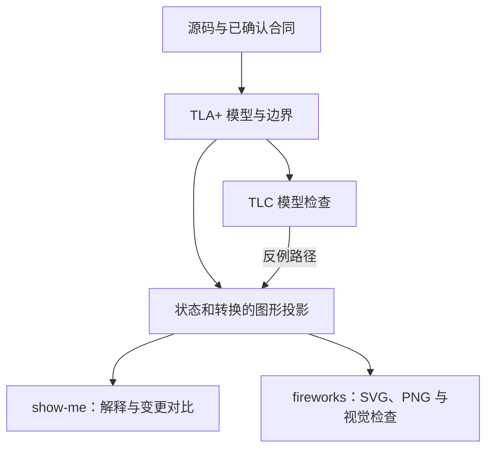

# 把 TLA+ 沉淀进生产项目

职责：调查现有形式验证 Skill 的内容、TLA+/TLC 的证据边界，以及生产项目中的维护路径。本文是调查记录，不是已实施合同。检索日期：2026-10-23。App Studio 的具体落点见后文同名节。

结论：`create-formal-verification-skill` 是创建器。长期资产是生产项目里的 TLA+ 模型、TLC 配置、项目专用 Skill、源码映射和同步记录。图形负责帮助人理解，TLC 负责检查声明范围内的模型性质；两者都不能单独证明真实实现正确。

## 现有能力与三层关系

入口是 [create-formal-verification-skill/SKILL.md](/Users/dimon/01-Personal/10-Projects/my-skills/skills/create-formal-verification-skill/SKILL.md:9)。配套维护入口是 [maintain-formal-verification-skill/SKILL.md](/Users/dimon/01-Personal/10-Projects/my-skills/skills/maintain-formal-verification-skill/SKILL.md:9)。这两个目录提供 agent 指令，没有捆绑 TLA+ 引擎或固定模型模板。开发机的 Java、TLC 安装状态和可用版本：Unknown，未在本次调查中运行检查。

```text
通用创建器：create-formal-verification-skill
  -> 阅读目标项目，选择性质，建立验证
项目专用 Skill：.agents/skills/formal-verify-<area>/SKILL.md
  -> 指导后续 agent 判断影响、检查同步、运行并解释结果
验证资产：TLA+ 模型、TLC 配置、固定工具版本与复跑命令
  -> 检查声明范围内的状态与执行顺序
```

首次建立验证时调用创建器。日常相关改动使用项目专用 Skill。跨提交累积了未经检查的变化，再调用维护器。创建器的默认生成位置属于其现有公开合同；模型与脚本的目录没有固定合同。[生成要求](/Users/dimon/01-Personal/10-Projects/my-skills/skills/create-formal-verification-skill/SKILL.md:33)

## 创建器的中文实质译文

以下覆盖原文全部实质内容，不把后文落地建议混入翻译。

### 目的

测试检查人想到并写出来的案例。形式验证检查声明范围内的所有情况：模型中每一种步骤顺序、某个边界内的所有输入，或全部输入。

这个 Skill 寻找仓库里最值得验证的部分，验证其中一条性质，再留下项目专用 Skill，让后续 agent 能据此检查改动。编写时要假设接手 agent 正在改代码，第一次读这个 Skill，完全不了解此前工作。用户无需学会验证语言，也应该能理解结果并据此行动。[原文：开头](/Users/dimon/01-Personal/10-Projects/my-skills/skills/create-formal-verification-skill/SKILL.md:9)

### 从代码选择目标

从代码库寻找答案。只有无法观察的信息才问用户。用户已经指定模块或缺陷时，从那里开始。

好目标是一条代码承诺：违背后会伤害用户，而普通测试很难覆盖触发违背的情况。应选择仓库中最值得验证的目标，不能只选最容易验证的目标。[原文：Choose the target from the code](/Users/dimon/01-Personal/10-Projects/my-skills/skills/create-formal-verification-skill/SKILL.md:11)

### 让问题决定工具

选择能以最低成本回答问题的工具：模型检查器、证明助手、基于 SMT 的验证器，或其他适合的工具。

事件是否会以错误顺序发生，通常适合建立小型设计模型，再做模型检查。这类问题默认使用 TLA+，不受产品代码语言限制。

代码是否对每个输入都正确，例如内存安全、溢出、数据结构不变量，通常适合直接验证代码的工具。目标语言没有适合的验证器时，要明确说明，并生成输入检查真实代码，不要手写一个函数模型代替它。性质必须对任意规模成立、有限边界不够时，可能需要证明。优先选择项目开发者能安装、能运行的工具，并向用户解释选择理由。[原文：Let the question choose the tool](/Users/dimon/01-Personal/10-Projects/my-skills/skills/create-formal-verification-skill/SKILL.md:17)

### 七条质量要求

1. **忠于代码。** 模型或证明的每个部分，都指向审查者能打开的代码。验证中视为不可分割的一步，在代码里也应不可分割。名称沿用项目术语。
2. **确实能失败。** 从未见过失败的检查不足以证明它有效。对每条性质展示一个错误变体，例如删除检查或调换步骤，并让该性质失败。
3. **发现的问题保持为问题。** 当前代码违反性质时，用代码术语和反例报告。不要为了通过检查而削弱性质或模型；未经用户要求，不改产品代码。
4. **如实交代范围。** 写明验证对象、边界、假设和省略内容。通过只覆盖声明的模型或边界，不能代表整个系统。
5. **不懂工具也能读懂。** 用一句普通话说明性质，再用一句话说明违反后的损害。把反例写成使用项目术语的简短步骤。
6. **低成本复跑。** 提供一条命令、可复现的工具版本和足够短的运行时间，让后续 agent 愿意在每次相关改动时运行。
7. **与代码保持同步。** 记录每项检查覆盖的文件、函数，以及最后确认验证准确描述代码的 commit。此后覆盖代码变化，就能识别需要重新核对。

来源：[原文：What makes it good](/Users/dimon/01-Personal/10-Projects/my-skills/skills/create-formal-verification-skill/SKILL.md:21)。

### 生成项目专用 Skill

写入 `.agents/skills/formal-verify-<area>/SKILL.md`。frontmatter 注明领域和触发条件；缺少 frontmatter，Skill 无法注册。

只读这个 Skill，后续 agent 就应能判断改动是否触及验证范围、运行检查、区分真实缺陷和建模错误，以及在预期行为变化时更新验证。

覆盖记录和 `sync commit` 写在 Skill 里。只有确认验证准确描述新 commit 的代码后，才能推进 `sync commit`。使用目标项目真实的命令、路径和术语，不留占位符。[原文：Generate the verify skill](/Users/dimon/01-Personal/10-Projects/my-skills/skills/create-formal-verification-skill/SKILL.md:31)

### 交付前证明它有效

按生成的 Skill 完整走一次。在真实代码中临时制造一个违反性质的改动，检查必须抓住它。随后撤掉临时改动，确认结果恢复：原来通过的仍通过；原来存在缺陷的，只保留将要报告的缺陷。

从未执行过的验证 Skill 只能算草稿。如果没抓住破坏，或某一步不能运行，应修验证 Skill 或验证套件，不能修改临时破坏来迁就检查。[原文：Prove it before you hand off](/Users/dimon/01-Personal/10-Projects/my-skills/skills/create-formal-verification-skill/SKILL.md:35)

### 交付说明

告诉用户：验证了什么、选择什么工具及原因、边界是什么、发现什么、怎样运行，以及没有覆盖什么。只有发现相邻的合适目标时，才建议第二个目标。相关代码改变后漏做验证，可以调用 `/maintain-formal-verification-skill` 补同步。[原文：Hand off](/Users/dimon/01-Personal/10-Projects/my-skills/skills/create-formal-verification-skill/SKILL.md:39)

## 官方资料确认的技术边界

### TLA+、PlusCal、TLC 各自做什么

TLA+ 描述状态、状态之间的动作和行为性质。PlusCal 可以把接近程序的算法描述翻译为 TLA+。TLC 对配置后的模型进行模型检查；TLC 不把产品源码自动翻译成 TLA+。[TLA+ 工具官方入口](https://github.com/tlaplus/tlaplus)、[官方命令行说明 USE.md](https://github.com/tlaplus/tlaplus/blob/master/USE.md)

模型里一条动作可能对应多行代码。若这些代码可以被其他执行者穿插，直接建成一个原子动作会隐藏真实交错。Lamport 的教程把一次增量拆成读取、写回后，展示了原先模型看不到的丢失更新。PlusCal 从一个标签到下一个标签构成一个原子步骤。[Lamport：The Grain of Atomicity](https://lamport.azurewebsites.net/tla/tutorial/session7.html?hide-col=true)、[Lamport：A Simple Example](https://lamport.azurewebsites.net/tla/peterson.html?back-link=high-level-view.html)

因此，源码映射不能只写函数名。事务、锁、条件更新、外部调用和持久化前后的间隙，都可能决定动作应在哪里拆开。此项是依据官方原子粒度示例作出的工程推断，不代表已有自动映射工具。

### Safety、liveness 与公平性

安全性质（safety）说坏事不能发生，违反时可以找到有限反例前缀。不变量是常见的安全检查：每个可达状态都应满足。活性性质（liveness）说好事最终应发生；一次有限运行没有观察到结果，通常不足以证明它永远不会发生。[Lamport：Safety, Liveness, and Fairness，第 2 节](https://lamport.azurewebsites.net/tla/safety-liveness.pdf)、[TLC 官方文档：Invariants 与 Properties](https://github.com/tlaplus/tlaplus/blob/master/toolbox/org.lamport.tla.toolbox.doc/html/model/overview-page.html)

弱公平性 `WF` 不允许一个持续可执行的动作永远得不到执行。强公平性 `SF` 进一步约束无限次变得可执行的动作。公平性属于规格假设；它不会让真实调度器、供应方或网络自动履行承诺。给活性加公平性前，应解释真实环境为何满足该假设。[Lamport：Safety, Liveness, and Fairness，第 4 节](https://lamport.azurewebsites.net/tla/safety-liveness.pdf)

工程推断：首片可先验证一条高价值安全性质。若引入“最终完成”，要另列外部服务恢复、重试继续被调度、进程有机会运行等前提，不能以加强公平性掩盖系统可能永久失败的事实。

### 有限边界与状态爆炸

TLC 可以检查有限状态实例；无限增长的队列、计数等会使穷举无法结束。状态约束会停止向不满足约束的状态之后继续探索，所以改变了实际探索范围。[TLC 官方文档：State Constraint](https://github.com/tlaplus/tlaplus/blob/master/toolbox/org.lamport.tla.toolbox.doc/html/model/spec-options-page.html#state)

对称性约简可以减少状态数，但 TLC 不替用户证明集合确实对称；错误声明会漏错。官方文档明确告诫：检查活性时不要使用对称集合，否则可能漏报或误报。[TLC 官方文档：Model Values and Symmetry](https://github.com/tlaplus/tlaplus/blob/master/toolbox/org.lamport.tla.toolbox.doc/html/model/model-values.html#symmetry)

工程推断：边界按待检查机制选择，并记录为什么足以暴露目标交错。某个小模型通过不能推出任意规模成立；也不能靠缩小边界、删去关键失败动作或加入目标不变量作为假设来换取通过。资源不足和运行超时都属于未完成。

### 模型通过与实现正确之间还有一层

AWS 的一手实践把形式规格用作设计演化和审查工具：修改设计、探索交错，再验证性质。论文同时明确承认，模型正确并不自动证明可执行代码实现了该模型。该经验支持长期保存模型，却不支持把 TLC 通过当作生产实现证明。[AWS 论文官方页](https://www.amazon.science/publications/how-amazon-web-services-uses-formal-methods)、[2015 年论文正文，第 6—7 页](https://cdn.amazon.science/67/f9/92733d574c11ba1a11bd08bfb8ae/how-amazon-web-services-uses-formal-methods.pdf)

Trace validation 提供更近实现的证据：记录真实执行中的相关状态和动作，检查该轨迹是否符合规格。作者的一手资料展示了这条路径；它检查收集到的轨迹，不穷尽实现的所有执行。[Merz 等：Validating Traces of Distributed Systems Against TLA+ Specifications，2024](https://conf.tlapl.us/2024-fm/slides-merz.pdf)

工程推断：先做源码映射、审查和最小反例复现。只有出现反复漂移或真实轨迹难以人工核对的证据，再评估 trace validation；不先建设通用插桩框架。

## 破坏性检查分别能证明什么

| 检查 | 能支持的结论 | 不能支持的结论 |
|---|---|---|
| 修改模型：删除 guard 或拆开动作，性质失败 | 模型中的性质能识别这类设计错误；配置确实启用该性质 | 真实代码与模型一致 |
| 修改真实代码，原样运行旧 `.tla` | 旧模型仍有原先结果 | 检查抓住了源码破坏；旧模型不会自动读取新代码 |
| 修改真实代码，按项目 Skill 检查差异、更新映射后捕获反例 | 生成的工作流程能识别这次破坏，并把变化带入验证 | 任意未来破坏都会被捕获 |
| 用真实入口重现反例 | 该具体缺陷在声明环境中可发生 | 穷尽全部交错或全部生产条件 |
| 验证真实执行轨迹符合模型 | 这些轨迹在所建映射和观察范围内符合规格 | 未记录的执行、遗漏事件和所有未来执行都正确 |

前三行区分来自创建器的现有破坏性检查要求与“模型不自动证明代码”的证据边界；后两行是基于该边界的工程推断。创建器要求破坏真实代码，所以交付时必须说明抓住破坏的是完整工作流程、真实代码检查，还是模型变体，不能互相替代。[创建器：交付前验证](/Users/dimon/01-Personal/10-Projects/my-skills/skills/create-formal-verification-skill/SKILL.md:37)、[AWS：模型与代码边界](https://cdn.amazon.science/67/f9/92733d574c11ba1a11bd08bfb8ae/how-amazon-web-services-uses-formal-methods.pdf)、[Trace validation 作者资料](https://conf.tlapl.us/2024-fm/slides-merz.pdf)

对 App Studio 这样的 Go 项目，建议分别记录三项证据：移除模型 guard 后 TLC 确实失败；只改 Go 时由源码变更触发对应关系复核，不能期待旧 TLC 自动变红；真实行为反例仍由相应现有 HTTP 测试复现。三项不能合写成“形式验证已证明生产实现”。

## 如何判定一次 TLC 运行

当前查阅的官方源码将无错误映射到退出码 `0`，并为性质违背、死锁、解析和求值错误提供不同退出状态。主入口按该映射退出。[`EC.ExitStatus.errorConstantToExitStatus`](https://github.com/tlaplus/tlaplus/blob/master/tlatools/org.lamport.tlatools/src/tlc2/output/EC.java)、[`TLC.main`](https://github.com/tlaplus/tlaplus/blob/master/tlatools/org.lamport.tlatools/src/tlc2/TLC.java)

但退出码 `0` 本身没有说明检查了哪条性质、选择了什么模式、是否得到所需的完整结果。官方成功消息 `TLC_SUCCESS` 与状态统计是不同输出；启动成功、解析成功和产生状态都不等于模型检查完成。[`MP.java`：TLC_SUCCESS、TLC_STATS](https://github.com/tlaplus/tlaplus/blob/master/tlatools/org.lamport.tlatools/src/tlc2/output/MP.java)

建议的成功合同：固定工具版本，读取实际命令与配置，确认目标性质已启用，在预定模式下完成检查，退出状态成功，并保留完成结果、状态统计、边界和所有警告。随机模拟只能报告采样结果；停止、超时、资源耗尽或只完成解析都不能写成穷举通过。TLC 的状态指纹碰撞估计也应随运行证据保留，而非被包装成无条件数学证明。该合同是工程建议，尚未实现判定脚本。

## 维护循环与变更审查

现有维护器只改验证资产，未经用户要求不改产品代码。它先运行旧检查，再从 `sync commit` 检查所有覆盖代码的变动，包括移动、拆分及新增的同状态写入者。根据真实代码更新模型；只有产品承诺有明确变更证据时才改性质。[维护器：Edit scope 与 Pass](/Users/dimon/01-Personal/10-Projects/my-skills/skills/maintain-formal-verification-skill/SKILL.md:22)

更新后重新运行，区分模型漂移和真实缺陷。通过后仍须用破坏证明检查有效。受阻时不推进同步点。输出可为 `in sync`、`updated`、`bug`、`blocked`；更新后发现缺陷可同时为 `updated` 和 `bug`。[维护器：Outcomes](/Users/dimon/01-Personal/10-Projects/my-skills/skills/maintain-formal-verification-skill/SKILL.md:11)

建议的最小维护合同如下。它补充长期落地要求，不冒充当前项目已有接线。

| 项目资产 | 最少记录 |
|---|---|
| 性质 | 普通话承诺、违反后的损害、需求或已接受合同来源 |
| 模型映射 | 变量对应的持久状态；动作对应的源码符号；原子性依据；未建模路径 |
| 运行范围 | 参与者、输入和重试边界；故障动作；公平性；约束及约简 |
| 复跑入口 | 固定工具版本、一条命令、预期时长、成功与失败语义 |
| 有效性证据 | 正常结果、故意破坏后的失败、反例解释；必要的真实代码复现 |
| 维护记录 | 覆盖代码、确认过的 `sync commit`、明确 owner |
| 审查入口 | 覆盖代码变化时核对模型；性质变化给出合同证据；模型与修复分别说明 |

建议先让本地复跑和正常变更审查可用，再把同一命令接 CI。CI 可以防止模型资产自身回归；若没有对应关系检查，它仍可能持续运行过时模型。运行成本、责任人、触发路径和失败处理确认前，不新增通用工作流或大范围门禁。

建议目录仅作为说明，不是创建器固定模板：

```text
目标项目/
├── specs/tla/<area>/
│   ├── <Area>.tla
│   └── <Area>.cfg
└── .agents/skills/formal-verify-<area>/
    └── SKILL.md
```

生产项目里实际使用的 Skill 必须写真实坐标和命令，不能照搬此示意中的占位符。若目标项目已经有形式规格目录或验证入口，应复用现有机制。

## 与 show-me、fireworks-tech-graph 的分工



[show-me](/Users/dimon/01-Personal/10-Projects/my-skills/skills/show-me/SKILL.md:7) 选择最小视图：用 Mermaid 解释局部状态机，用 diff 比较转换变化，用步骤展示反例。不必每次生成完整系统图。

[fireworks-tech-graph](/Users/dimon/03-System/10-Toolchains/fireworks-tech-graph/skills/fireworks-tech-graph/SKILL.md:214) 提供正式状态图语义：状态、初末节点、`事件 [条件] / 动作`、嵌套和并发结构。其几何校验、PNG 回看和导出门槛负责图形质量，不能判定业务性质成立。[图形工作流与视觉复核](/Users/dimon/03-System/10-Toolchains/fireworks-tech-graph/skills/fireworks-tech-graph/SKILL.md:77)

建议图从同一份模型和反例出发，保留动作名与规格坐标。简化图注明省略的变量、guard、并发维度和范围。业务生命周期图通常只是完整状态空间的投影；同名业务状态在其他变量取值不同时仍可能是不同模型状态。当前没有证据表明这几个 Skill 已具备自动规格到图的语义核对流程。

官方工具支持导出状态图 DOT 和模型错误轨迹 JSON，可作为后续呈现的输入。具体能力取决于选定版本；这些输出不等于已经接上 show-me 或 fireworks，也不要求先做一层通用转换 DSL。[TLA+ 官方 USE.md：From a non-Java Application](https://github.com/tlaplus/tlaplus/blob/master/USE.md)

## App Studio 代码落点

待主 agent 根据只读源码调查补入。此节需要真实路径、符号、持久状态、候选性质及其合同来源；不得把示例性质当作已接受需求。

当前项目选择、首个模型范围、可运行命令、TLC 结果和生产缺陷结论：Unknown。

## 来源与证据限制

外部来源均为官方文档、工具源码或作者一手实践；检索日统一为 2026-10-23。GitHub `master` 指针描述当日查阅内容，实施时需选定可复现工具版本，不应把移动分支当作固定版本。

- [TLA+ 工具官方仓库](https://github.com/tlaplus/tlaplus)：TLC、工具分工和 CLI。
- [官方 USE.md](https://github.com/tlaplus/tlaplus/blob/master/USE.md)：命令行、DOT 和 JSON 导出。
- [Lamport：PlusCal Tutorial，Session 7](https://lamport.azurewebsites.net/tla/tutorial/session7.html?hide-col=true)：原子粒度与丢失更新。
- [Lamport：Safety, Liveness, and Fairness](https://lamport.azurewebsites.net/tla/safety-liveness.pdf)：性质与公平性的精确定义。
- [TLC Model Overview](https://github.com/tlaplus/tlaplus/blob/master/toolbox/org.lamport.tla.toolbox.doc/html/model/overview-page.html)：规格、不变量和时序性质配置。
- [TLC Spec Options](https://github.com/tlaplus/tlaplus/blob/master/toolbox/org.lamport.tla.toolbox.doc/html/model/spec-options-page.html)：状态约束和定义覆盖。
- [TLC Model Values and Symmetry](https://github.com/tlaplus/tlaplus/blob/master/toolbox/org.lamport.tla.toolbox.doc/html/model/model-values.html)：对称性约简边界。
- [EC.java](https://github.com/tlaplus/tlaplus/blob/master/tlatools/org.lamport.tlatools/src/tlc2/output/EC.java)、[TLC.java](https://github.com/tlaplus/tlaplus/blob/master/tlatools/org.lamport.tlatools/src/tlc2/TLC.java)、[MP.java](https://github.com/tlaplus/tlaplus/blob/master/tlatools/org.lamport.tlatools/src/tlc2/output/MP.java)：退出码与完成消息。
- [AWS 一手论文正文](https://cdn.amazon.science/67/f9/92733d574c11ba1a11bd08bfb8ae/how-amazon-web-services-uses-formal-methods.pdf)：生产设计演化价值，以及模型与实现的区别。
- [Merz 等，2024 年作者报告](https://conf.tlapl.us/2024-fm/slides-merz.pdf)：用实现轨迹检查规格对应关系。

未安装或运行验证工具，未创建项目专用验证 Skill，未修改生产项目。本文没有证明任何 App Studio 性质，也没有自动规格与图一致性检查的运行证据。
