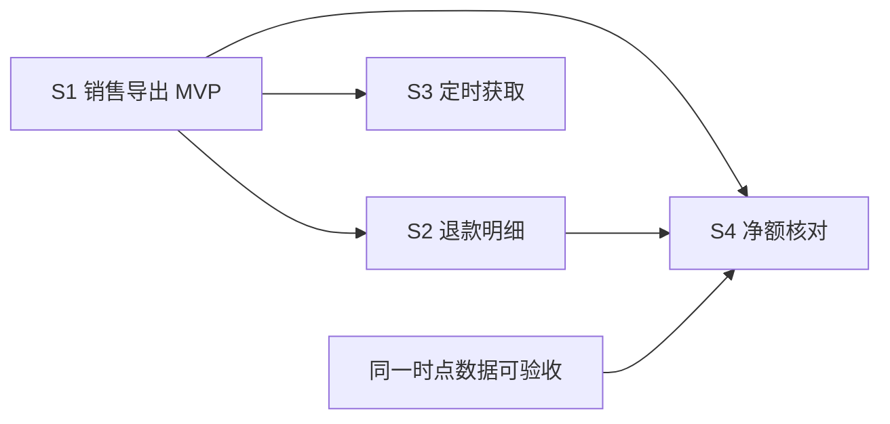

# Epic → Spec 拆分：先验证，再按业务边界并发

职责：为拟议的 `to-epic` 提供一手资料研究与拆分建议。日期：2026-11-04。本文是调查记录，建议尚未写入运行合同。

## 结论与已确认边界

建议组合使用：**Story Mapping 保住整体目标，核心薄路径选择首片，业务结果或变体形成后续 Spec，真实能力依赖与学习依赖决定并发。** 不采用固定 Spec 数量、固定并发数或统一评分阈值。

用户已确认：

- `Epic → 多个 Spec → 各 Spec 内的 tickets`。
- 一个 Spec 对应一个 MR。Spec 是交付边界，ticket 是内部执行边界。
- 拟将 `epic-planner` 收敛为 `to-epic`，负责整体目标、Spec 候选、排序和真实依赖；当前候选由 `to-spec` 细化，再由 `to-tickets` 拆实施工作。
- 独立性约束已确认：`to-epic` 与 `to-spec`、`to-tickets` 类似，可独立调用，不强耦合 `delivery-pipeline`；pipeline 是可选调用方。
- Q3 已确认：首份 Spec 优先选择核心、小、能验证关键未知的完整业务路径；需求已清楚时直接做最小完整交付。
- Q5 已确认：在已批准的 Epic 结果与约束内，agent 自主细化 Spec、合并或拆分尚未开工的候选、依据事实更新依赖，并报告实质变化。新增、删除或改变已批准结果与验收、关键业务语义取舍、超出现有授权的成本或不可逆影响仍交用户决定；已开工工作先协调影响，远程发布、合并与部署沿用既有授权。
- Epic → Spec 的拆分必须遵循 [codebase-design](/Users/dimon/.agents/skills/codebase-design/SKILL.md)，使用 Module、Interface、Implementation、Depth、Seam、Adapter、Leverage、Locality 的既有定义。
- Q4 已确认：先明确当前及准备并发 Spec 的 Module 职责、共享状态 owner 和跨 Spec Interface，再并发推进 Implementation；真实能力依赖继续约束验收交付。远期候选保留尚不影响当前交付的未知，不要求整个 Epic 的设计一次性冻结。

**职责归属调整（推断）：** 独立调用要求内容规则归对应 Skill：`to-epic` 拥有整体结果到 Spec 候选的覆盖、切分和依赖；`to-spec` 拥有单份 Spec 的 Interface、验收要求及验证方式；`to-tickets` 拥有该 Spec 到实施票的覆盖和执行依赖。`delivery-pipeline` 消费这些产物并拥有执行、交接和证据核验规则，不成为这些 Skill 必需的调用环境，也不复制其内容规则。

**规范应用说明（推断）：** Spec 表达交付范围，Module 表达设计职责；两者不要求一一对应。一份 Spec 可以穿过多个已有 Module，多份 Spec 也可以逐步加深同一个 Module。拆分应使复杂度收敛到拥有它的 Module，通过小而完整的 Interface 提供能力，并沿调用方使用的 Seam 验证；不因 Spec 数量增加而机械新增 Module、Seam 或 Adapter。

**一 Spec 一 MR 是本次用户选择，不是下列来源规定的行业标准。** 把行业方法映射到这个层级，以及本文的流程、判据和示例，均为推断与提案。用户所述“约 80% 完成度”未经历史样本复算；当前基线、预期收益和最优并发数均为 Unknown。

## 本地约束：复用机制，调整交付层级

[研究时的 epic-planner](https://github.com/Dimon94/skills/blob/89bf7a32cc26808e6aba94215549297b03af6bc6/skills/epic-planner/SKILL.md) 的“史诗迷雾与循环”要求全部范围内的史诗战略迷雾清除后才形成计划；[形成 epic-plan](https://github.com/Dimon94/skills/blob/89bf7a32cc26808e6aba94215549297b03af6bc6/skills/epic-planner/references/plan.md) 第 2 节要求至少两张候选地图。它服务于多地图战略寻路，和当前已确认的 Spec/MR 交付边界不同。

[vertical-slicing](../../skills/vertical-slicing/SKILL.md) 已有业务主线、核心闭环、walking skeleton、按 Interface 或能力连依赖的判据。但其“垂直切片”目前定义为一张 ticket，“执行交接”指向一票一 MR。重用这些判据时，必须先区分 **Spec 级独立交付** 与 **Spec 内部 ticket 执行**；不能直接沿用旧交接单位。

本次仅新增研究报告。未改动上述 Skill、运行时链接、pipeline、L1–L6 合同、Issue 或 Git 提交。

## 行业实践：五类方法的作用与取舍

| 方法 | 一手资料中的做法 | 对 Epic → Spec 的用途（推断） | 成本与局限 |
| --- | --- | --- | --- |
| **Story Mapping** | 按用户活动组织 backbone，将必要行为放高、变体放低，用 release 泳道表达逐步交付。[S1] | 先画用户旅程和整体结果，再选第一条完整薄路径；后续候选始终能指回整体目标。 | 需要澄清活动与结果；地图泳道本身不能证明技术独立或可并发。 |
| **垂直切片与变体缩减** | Humanizing Work 先找核心复杂度，再列业务规则、数据、路径等变体，缩成一条完整路径；随后逐个加厚。[S2] | 首片直接触碰关键复杂度；后续按可分别验收、推迟或取消的业务结果/变体拆 Spec。 | 切片需要业务判断；“每片都很薄”仍不能保证整体目标齐全。纯技术贯通也不证明用户需求成立。 |
| **Shape Up：先完成一片，再发现 scopes** | 先做可操作的集成片，选 core、small、novel；scope 是可以独立完成的相关工作块。作者明确 scope mapping 需要通过实际工作发现依赖。[S3][S4] | 当前 Spec 详细、远期候选保留目标与前置；用已完成片的事实修正后续边界。 | 边界会重画，不能承诺开工前一次拆准。本文不移植其六周周期或整套管理流程。 |
| **DORA：小批量交付** | 尽可能让工作独立、可协商、有价值、小且可测试；警惕拆小后又在测试或发布时重新攒大。[S5] | 一个 Spec/MR 自身就是可验收的小批次；内部 tickets 变小不能替代 Spec/MR 变小。 | 约束交付体积与反馈速度，不提供发现业务领域的算法。来源的小时到数天是建议尺度，不是本仓硬性 SLA。 |
| **按业务能力组织、检查松耦合** | DORA 关注独立验收、测试、部署，以及减少细粒度跨团队协调；明确契约、数据升级和依赖的重要性。[S6] | 以业务结果或能力提候选，用实际协调和状态耦合检查边界；领域名只用于提出假设。 | 独立测试和接口治理有成本；领域不等于微服务，也不要求为 agent 并发先拆服务或建设平台。 |

对交付速度的取舍是尽早反馈与过多切换之间的平衡；对维护性的取舍是边界清晰与过多临时接口之间的平衡；学习成本主要来自业务结果澄清和识别真实依赖。上述来源不支持本项目的具体提速比例。

## 首片：分清需求验证、技术贯通与交付验证

Ries 将 MVP 定义为以最少努力获得客户的 validated learning，并明确这需要判断，不是公式；需求已清楚时，强行组织 MVP 学习也会增加开销。[S7]

因此建议按实际未知选择证据：

| 要回答的问题 | 合适证据 | 证据的限度 |
| --- | --- | --- |
| 用户是否需要、能否用它完成工作？ | 目标用户使用最小版本完成真实任务，观察是否解决目标问题。 | 内部演示、API 成功或测试全绿不能单独回答。 |
| 技术路径能否成立？ | 代表性数据穿过关键计算、集成和持久状态，结果可核对。 | 小数据通过不证明容量；技术路径通过不证明客户价值。 |
| 能否交付并取得反馈？ | 实际构建、验收、部署与观测结果。 | MR 合入、部署、外部放量分别留证，不互相替代。[S5][S8] |

首份功能 Spec 优先选择 **核心、小、包含关键未知** 的一条完整路径。[S2][S3] 已有可信答案就直接交付，只有会实质改变当前选择的未知才需要额外取证。能用更小探针回答技术问题时，不必先造一个完整产品；探针仍不能冒充功能交付。

MVP 可以缩用户群、数据范围、格式、路径和非必要美化。对本片已开放的行为，金额、授权、租户隔离和数据不变量按当前暴露面保证成立；不预建尚未涉及的规模、重试或恢复体系。这是本次约束下的建议，不是将某个作者的演示安全配置推广到实际产品。

## 建议进入 to-epic 的五步流程

### 1. 写清整个 Epic 要实现的用户结果

用一句目标、必要的业务主线和验收结果集合保住整体。每项结果后续要么由某个 Spec 承接，要么明确等待，要么经范围决定延后/取消。首个 MVP 通过不代表 Epic 完成。

### 2. 选择首份 Spec

缩到最简单的完整业务路径，保留这片真正需要验证的关键未知。写清谁从哪个入口得到什么结果，以及什么证据足以验收。遇到影响可行性的未知，先做最小探针；不为凑齐调研票型建立额外流程。

### 3. 按业务结果或变体提出后续候选

常见切法是用户活动、业务规则、数据范围、操作、输入方式和简单/复杂变体。[S2] 每个功能候选都要有自己的结果和验收边界；不把数据库、API、UI 三层分别当成三个业务 Spec。

候选只保留最少信息：**用户结果、验收依据、能力前置、可能改变边界的关键未知、下一动作**。远期 tickets 留待对应 `to-spec → to-tickets` 阶段细化。结构或迁移工作确需独立 Spec 时，明确它服务哪个业务结果、保持什么不变量和何时完成，避免纯基础设施长期吞掉交付。

### 4. 分别检查能力依赖与学习依赖

| 依赖类型 | 具体问题 | 处理建议 |
| --- | --- | --- |
| **能力依赖**（本文分析用语） | 所需接口、服务、数据、权限规则或迁移状态是否真实可用？ | 写明依赖什么、谁提供、用什么检查证明就绪。提供者的预计完成日期不能替代能力验收。 |
| **学习依赖**（本文分析用语） | 首片的一项关键反馈，会不会改变该候选的边界、业务口径或验收？ | 明确反馈点和可能改变的决定；只等待受影响部分，或在范围内选择返工可接受、可保留的工作。 |

还要检查共同状态和不变量：两个领域都写同一账本、共同决定权限或必须原子切换时，可能是真耦合。两张票修改同一普通文件，单独只能说明冲突风险。

**并发开发与独立交付分开判断。** 接口语义已确定且写入可隔离时，可以考虑并发实现；但受控 fake 或契约样例只证明其覆盖范围。真实 provider 尚未就绪，交付依赖仍然保留，不能把模拟通过记为真实功能完成。是否使用这种并发方式取决于现有架构与工具，不要求新增平台或兼容层。

### 5. 用实际反馈只重切受影响候选

首片完成后，检查哪些假设得到支持、哪些验收或依赖改变，再推进下一批就绪 Spec。保留已有有效决定，避免重审整个 Epic；后续未知只要不影响当前交付，就保持在候选中。没有证据支持固定分成几个领域或固定开多少并行 agent。

单个 MR 太大时，优先缩业务变体或重切可独立结果；必须共同维护同一不变量、拆后互等且无法分别验收时，考虑合并。涉及存量消费者的破坏性变化，可按真实迁移需求使用 expand → migrate → contract，并明确删除条件；不为普通小改动默认引入双轨。[S9]

## 具体盲点与跨学科核查

**盲点：接口不变，不代表并发计划仍然有效。** 例如首片对账发现用户按“到账日期”核对，而后续退款、定时报表已经按“订单日期”实现，即使 API 签名没变，也可能同时返工。这是推断反例，发生频率尚未由本仓历史样本验证。

已读行业资料并未忽略未知：Humanizing Work 承认复杂问题会涌现依赖，Shape Up 强调做过才会发现 scopes，DORA 检查契约及独立交付。[S2][S4][S6] 本次读到的材料没有直接给出针对上述反例的最优开工时刻算法；不能把这个阅读范围的缺口扩大为“全行业没有”。

第二阶段查了决策分析的样本信息期望价值（EVSI）。其机制是比较取得某项观察后可以选择的最佳行动，与未取证时的最佳行动；减少未知只有在可能改善行动时才有决策价值。[S10][S11] 数值估计需要可信的状态概率、观察分布和各行动价值；当前输入不足，且真实 MVP 同时改变系统并交付价值，不能直接套入静态研究模型计算并发数量。

可迁移的是一个简单的**结果分支检查**：对会影响候选的具名观察，写出合理结果，以及每种结果是否会让我们保留、重切或取消这个候选。结果都不改变当前承诺，就不因该未知让它停工；结果会改写验收时，明确反馈点，只延后受影响承诺。这个检查用于当前可识别的关键分支，不要求穷尽所有未来发现。

**新颖性核查结果：本行业已有，可复用。** 回搜 `software architecture value of information`、`software engineering expected value sample information`、`agent planning metareasoning value of computation`，并定向核查软件实践中的 `Real Options` 和 `validated learning`：

- 命中 ICSE 2014 的软件需求/架构信息价值论文；仅核验出版元数据，全文不可读，不引用其算法。[S12]
- 已读 Berkeley 2011 技术报告的摘要及 §1–3.1，包含信息改善最终决策与计算成本的权衡；不据此声称它可调度软件团队。[S13]
- 敏捷 Real Options 的原作者文章及 Ries 的 MVP 已有推迟承诺、带目的取证的实践。[S14][S7]

因此不引入数值评分器、概率预测台账或新的“跨学科规划平台”。本次补充的是把 **观察 → 会改变的决定 → 承诺条件** 写清，而非发明一种行业尚不存在的方法。

## 导出报表 Epic 示例

以下全为推断示例，不是用户真实业务结论。假设目标为“财务按权限导出销售与退款、核对净额，并按计划获取报表”；既有销售读取能力、身份和文件下载能力可用，退款读取能力需要核对，同一时点净额快照尚未证明可用。

| Spec 候选 | 用户结果与验收 | 先后关系及关键未知 |
| --- | --- | --- |
| S1 销售导出 MVP | 有限日期范围、一种 CSV，完成选范围 → 生成 → 下载 → 与已知账目核对。 | 首片同时检查当前交付路径；存在需求未知时让财务完成真实对账，确认日期与金额口径。 |
| S2 退款明细导出 | 按已确认口径取得可核对的退款明细。 | 退款状态、金额和权限能力须有就绪证据；若日期口径受 S1 反馈影响，等待对应决定。 |
| S3 定时获取销售报表 | 用户设定计划，任务按已确认规则生成报表，授权用户可取得结果。 | 生成接口、任务和文件归属语义须明确；当前命中的撤权、失败或重复副作用风险需验证，不扩展到假想规模。 |
| S4 销售/退款净额核对 | 在相同快照时点取得可解释、可核对的净额。 | 依赖 S1/S2 的相关能力与同一时点数据。两个 CSV 各自完成不自动证明快照成立。 |

当 S1 的相关反馈已取得，且 S2/S3 各自前置满足时，两者可并发；S4 仍等待自己的真实能力，不等所有无关 Spec 完成。若 S2 的能力或语义在开始时就已有可靠证据，也可以独立评估更早开工，无需机械等待一次 MVP 仪式。

图只表达本示例假设下的依赖；“同一时点数据可验收”是能力条件，不预设必须新建一份基础设施 Spec。S2 与 S3 之间没有凭领域名称编造的阻塞边。每个 Spec 内的 tickets 合入本 Spec 的一个 MR，不能按旧规则把每张 ticket 都独立发布。

## 验证拆分是否有用

本文没有用模型打分或格式检查证明切分正确。建议选择一个实际 Epic 试用，或封存一个历史 Epic 在当时已知的信息后回放，观察：

- 首个可用结果在何时出现、取得什么反馈，以及哪项后续决定因此改变。
- 哪些 Spec 的并发引发等待或返工，属于能力未就绪还是业务语义改变。
- 哪些候选没有独立验收价值而需要合并，哪些 Spec 过大而需要再切。
- Epic 收口时，原验收结果是否都有证据或明确范围决定；人为补代码/接线发生在哪里。

这些是试用观察项，不要求新增监控系统或合成总分。尚未实测真实需求的周期、返工率或完成度；不得承诺“提高到 100%”或“快一半”。后续方法与流程仍需逐项确认。

## 一手来源与读取范围

统一访问日期：2026-11-04。多数网页没有固定修订号。后台依次完成行业研究和针对盲点的跨学科研究；父会话重新读取并核对 Shape Up 两章、Humanizing Work、DORA 两页和 Ries 作者正文。以下不将网页阅读扩展为读过全书、付费课程或完整研究体系。

- **[S1] Jeff Patton，The New User Story Backlog is a Map**：[作者文章的 2023-09-30 存档](https://web.archive.org/web/20230930194242/https://jpattonassociates.com/the-new-backlog/)。读取 backbone、walking skeleton、release 泳道等正文；原文日期 2008-10-08。作者现站受限，未核验 2014 年书全文。
- **[S2] Richard Lawrence / Peter Green，The Humanizing Work Guide to Splitting User Stories**：[原作者指南](https://www.humanizingwork.com/the-humanizing-work-guide-to-splitting-user-stories/)。读取九种切法、meta-pattern、评估拆分、Cynefin 与 scale。未据其 QuickBooks 假设示例声称 Intuit 生产实践。
- **[S3] Ryan Singer / Basecamp，Get One Piece Done**：[Shape Up 第 11 章](https://basecamp.com/shapeup/3.2-chapter-11)。核对垂直集成、core/small/novel 和真实操作反馈；不移植演示中的具体安全配置。
- **[S4] Ryan Singer / Basecamp，Map the Scopes**：[Shape Up 第 12 章](https://basecamp.com/shapeup/3.3-chapter-12)。核对 scopes、发现依赖、重画与切分信号；不声称每个 scope 天然对应一个 Spec/MR。
- **[S5] DORA，Working in small batches**：[官方文档](https://dora.dev/capabilities/working-in-small-batches/)。核对 INVEST、小批次、反馈与下游攒批陷阱；不是本项目的耗时基准。
- **[S6] DORA，Loosely coupled teams**：[官方文档](https://dora.dev/capabilities/loosely-coupled-teams/)。核对独立验收/测试/部署、契约、数据升级与协调开销；不将其当成 DDD 或 Team Topologies 全套原著核验。
- **[S7] Eric Ries，Minimum Viable Product: a guide**：[2009-08-03 作者正文](https://www.startuplessonslearned.com/2009/08/minimum-viable-product-guide.html)。核对 validated learning 定义、额外学习开销和非公式化 caveats；未读取视频作为证据。
- **[S8] Pete Hodgson，Feature Toggles**：[2017-10-09 原作者文章](https://martinfowler.com/articles/feature-toggles.html)。读取 Release Toggles 和 carrying cost；支持部署与放量区分，不规定每个 Spec 都要开关。
- **[S9] Danilo Sato，Parallel Change**：[2014-05-13 原作者文章](https://martinfowler.com/bliki/ParallelChange.html)。读取 expand、migrate、contract 与双版本成本；不规定 Spec/MR 数量。
- **[S10] Strong 等，Estimating the Expected Value of Sample Information Using the Probabilistic Sensitivity Analysis Sample**：[大学存档](https://eprints.whiterose.ac.uk/id/eprint/87841/)、[全文 PDF](https://eprints.whiterose.ac.uk/id/eprint/87841/7/Estimating.pdf)。后台读取 pp.570–575，尤其 p.571 的假定与 p.572 式 1–4；不迁移其医疗案例、回归估计或收益结论。
- **[S11] Claxton 等，A Pilot Study of Value of Information Analysis to Support Research Recommendations for NICE**：[York/Sheffield 报告](https://www.sheffield.ac.uk/media/34161/download?attachment)。后台读取摘要及第 1 章相关段，特别正文 pp.7–8 的参数未知、决策未知、研究成本和延迟；未核验全部案例。
- **[S12] Letier / Stefan / Barr，Uncertainty, risk, and information value in software requirements and architecture**：[ICSE 2014 DOI](https://doi.org/10.1145/2568225.2568239)、[出版元数据](https://api.crossref.org/works/10.1145/2568225.2568239)。只核对标题、作者与 DOI；全文不可读，不承担算法证明。
- **[S13] Hay / Russell，Metareasoning for Monte Carlo Tree Search**：[Berkeley 技术报告](https://www2.eecs.berkeley.edu/Pubs/TechRpts/2011/EECS-2011-119.html)、[全文](https://www2.eecs.berkeley.edu/Pubs/TechRpts/2011/Archive/EECS-2011-119.pdf)。后台读取摘要和 §1–3.1；模拟与真实行动有不同成本，不能直接套用团队排程。
- **[S14] Chris Matts / Olav Maassen，“Real Options” Underlie Agile Practices**：[2007-06-08 原作者文章](https://www.infoq.com/articles/real-options-enhance-agility/)。后台读取承诺条件与 Decision process，作为已有软件实践证据；父会话再次抓取遇 TLS 失败。未采纳文章的所有最优性或心理学主张。

[S1]: https://web.archive.org/web/20230930194242/https://jpattonassociates.com/the-new-backlog/
[S2]: https://www.humanizingwork.com/the-humanizing-work-guide-to-splitting-user-stories/
[S3]: https://basecamp.com/shapeup/3.2-chapter-11
[S4]: https://basecamp.com/shapeup/3.3-chapter-12
[S5]: https://dora.dev/capabilities/working-in-small-batches/
[S6]: https://dora.dev/capabilities/loosely-coupled-teams/
[S7]: https://www.startuplessonslearned.com/2009/08/minimum-viable-product-guide.html
[S8]: https://martinfowler.com/articles/feature-toggles.html
[S9]: https://martinfowler.com/bliki/ParallelChange.html
[S10]: https://eprints.whiterose.ac.uk/id/eprint/87841/7/Estimating.pdf
[S11]: https://www.sheffield.ac.uk/media/34161/download?attachment
[S12]: https://doi.org/10.1145/2568225.2568239
[S13]: https://www2.eecs.berkeley.edu/Pubs/TechRpts/2011/EECS-2011-119.html
[S14]: https://www.infoq.com/articles/real-options-enhance-agility/
