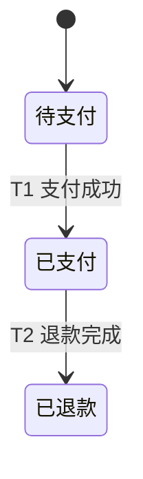

This skill takes the current conversation context and codebase understanding and produces a spec. Do NOT interview the user; just synthesize what you already know.

The issue tracker and triage label vocabulary should have been provided to you. If not, tell the user to run `/setup-matt-pocock-skills`.

## Process

1. Explore the repo to understand the current state of the codebase, if you haven't already. Use the project's domain glossary vocabulary throughout the spec, and respect any ADRs in the area you're touching. 按运行时目录定位并完整读取 `codebase-design/SKILL.md`，Module、Interface、Seam 等词按它的定义使用。依赖缺失时点名路径和受影响决定，把 Spec 标为未就绪。

2. 判定 MMF。Spec 描述一个 MMF：验收、合入与上线的单位，对应一个 MR。用两个问题判定需求：切成两半，存在一种切法让每半都能单独上线且单独有人用吗；整体单独上线有人用吗。结果取其一：
   - 切得开 → 多个 MMF：停下，请用户运行 `/to-epic`，列出已识别的 MMF 候选及各自的用户结果。
   - 切不开，且整体单独上线有人用 → 正好一个 MMF：继续。
   - 整体单独上线没人用 → 不足一个 MMF：停下，说明它是某个 MMF 里的 ticket，点名所属 MMF；不知道写 Unknown。
   完成条件：结果是三者之一，两个问题各有答案和依据。

3. 判定 Business Flow。行为的状态跨越步骤或时间留存，或者包含失败重试、审批、取消、不可逆副作用时，按模板画状态图；其余情况在该节写 `N/A` 和一句理由。完成条件：该节是一张图加规则，或一条 `N/A` 理由。

4. Sketch out the seams at which you're going to test the feature. Existing seams should be preferred to new ones. Use the highest seam possible. If new seams are needed, propose them at the highest point you can. The fewer seams across the codebase, the better - the ideal number is one.

Check with the user that these seams match their expectations.

5. Write the spec using the template below. 发布前逐项核对：每个 T 和 R 都有唯一 owner Module，也都出现在 Testing Decisions；每个新建或修改的 Module 都用代码写了 Interface，也写了 Seam，跨 Module 的 R 都列了参与方，命中分支链或同步标志位的写明数据形状决定。有缺口先补，补不上的写 Unknown 并点名影响。Then publish it to the project issue tracker. Apply the `ready-for-agent` triage label - no need for additional triage.

<spec-template>

## Problem Statement

The problem that the user is facing, from the user's perspective.

## Solution

The solution to the problem, from the user's perspective.

## Business Flow

The states the feature moves through and the rules that must always hold, in the reader's words. Write `N/A` and one reason when step 3 finds no business state.

<business-flow-example>

- R1：同一笔订单只能退款一次

未列出的转移一律禁止。每个 T 和 R 都是这个 MMF 的 MR 验收项。

</business-flow-example>

- 状态和箭头用读者能看到或在意的业务词，代码名和变量名留给 Implementation Decisions。
- 箭头写成 `T<n> 事件 [条件]`，失败、取消和重试也各占一条箭头。规则写成 `R<n>`，表达必须一直成立的事。
- 状态和转移只在本节定义，User Stories 负责说明为什么需要这些行为。
- 箭头控制在约 20 条。超出时先合并读者不区分的状态；仍读不清，说明它不止一个 MMF：停下，请用户运行 `/to-epic` 重切 MMF。

## User Stories

A LONG, numbered list of user stories. Each user story should be in the format of:

1. As an <actor>, I want a <feature>, so that <benefit>

<user-story-example>
1. As a mobile bank customer, I want to see balance on my accounts, so that I can make better informed decisions about my spending
</user-story-example>

This list of user stories should be extremely extensive and cover all aspects of the feature.

## Implementation Decisions

A list of implementation decisions that were made. This can include:

- The modules that will be built/modified
- The interfaces of those modules that will be modified
- Technical clarifications from the developer
- Architectural decisions
- Schema changes
- API contracts
- Specific interactions

Use `codebase-design` terms. For each Module built or modified, state:

- Which T and R it owns (omit when Business Flow is `N/A`). 一条 R 要靠多个 Module 共同守住时，在 owner 下写 `Participants:`，列出其余 Module；每个参与方在相关签名的 `Ensures:` 里回引 R 编号
- Its Interface, written as code：用目标项目的语言写类型和函数签名，函数体留空。选错会破坏 T、R 或调用方的签名，在下面加 `Ensures:`，列返回承诺、错误模式和顺序约束；其余签名只留一行说明
- Its Seam: reuse an existing one first; justify a new one by the Adapter rule in `codebase-design`
- For a new Module, the result of the deletion test
- Its data shape decision, when the requirement would add one more branch to an existing if/else or switch chain, or a second flag that must stay in sync with an existing one: read `principle-model-the-domain` and `principle-redesign-from-first-principles` in full from the runtime skill directory, then record the changed shape or why the branch stays

Interface 代码只写控制实现所需的决定，写短。

Do NOT include specific file paths. They may end up being outdated very quickly.

If a prototype produced a snippet that encodes a decision more precisely than a signature can (state machine, reducer, schema), inline it within the relevant decision and note briefly that it came from a prototype. Trim to the decision-rich parts, not a working demo, just the important bits.

## Testing Decisions

A list of testing decisions that were made. Include:

- A description of what makes a good test (only test external behavior, not implementation details)
- Which modules will be tested
- Prior art for the tests (i.e. similar types of tests in the codebase)
- How each T and R is checked through the Interface; each R's check must fail under a wrong implementation
- For any R involving money, concurrency, duplicated side effects or irreversible steps: the project's `formal-verify-*` skill that checks it, or the need to generate one with `create-formal-verification-skill`

## Out of Scope

A description of the things that are out of scope for this spec.

## Further Notes

Any further notes about the feature.

</spec-template>
