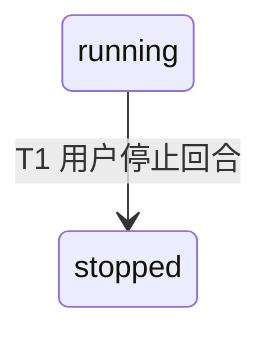

# 停止回合并保留部分结果

## Problem Statement

回合已经显示第一段结果。用户想停止生成，并继续查看已经得到的内容。

## Solution

回合详情提供停止操作，同时保留当前回合的结果。

## Business Flow



- R1 停止前已显示的结果在停止后仍可读。

## User Stories

1. 作为用户，我要在回合详情停止生成，再读到停止前看到的第一段结果。

## Implementation Decisions

**回合详情**

Owns: running, stopped, T1, R1

```ts
declare function stop(turn: Turn): Turn;
```

Ensures: 返回的回合状态为 `stopped`，保留停止前已有的结果。

## Testing Decisions

| id | covers | given | when | then | source | seam |
| --- | --- | --- | --- | --- | --- | --- |
| S1 | T1, R1 | 回合正在生成，详情中已显示「第一段」 | 用户在回合详情点击停止 | 回合显示已停止，详情仍可读到「第一段」 | MMF A 的 Testing Decisions「停止回合保留部分结果」 | 回合详情的停止操作与结果读回 |

## Dependencies

Repo: stop-turn-example

Blocked by: 无，回合详情可以独立验收。

Blocks: 无，本例只交付停止操作。

## Out of Scope

重复停止的语义留待需求作者裁决。

## Further Notes

`S1` 标识本 Spec 的同一场景。结果文本「第一段」取自场景前提。
